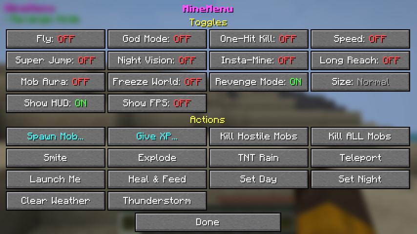

The first release of MineMenu: a singleplayer-only fun menu for **Minecraft Java 1.21.1** (Fabric).

## Install

1. Install the [Fabric Loader](https://fabricmc.net/use/installer/) for Minecraft **1.21.1**.
2. Put [Fabric API](https://modrinth.com/mod/fabric-api) (1.21.1) and **`minemenu-1.0.0.jar`** (below) in your `.minecraft/mods` folder.
3. Open a singleplayer world and press **Right Shift**.

## Features

**Toggles:** Fly, God Mode, One-Hit Kill, Speed, Super Jump, Night Vision, Insta-Mine, Long Reach, Mob Aura, Freeze World, Size (Normal / Giant / Tiny), Show HUD.

**Actions:** Kill Hostile Mobs, Kill ALL Mobs, Smite, Explode, TNT Rain, Teleport, Launch Me, Heal & Feed, Set Day / Night, Clear Weather / Thunderstorm.

Optional keybinds for Toggle Fly, Toggle God Mode and Kill Hostile Mobs can be set in Options → Controls → Key Binds → MineMenu.

## Notes

- Works only in your own singleplayer worlds. It does nothing on multiplayer servers and switches off if you open the world to LAN.
- Explode and TNT Rain break blocks, so use a test world or make a backup.
- Everything is switched off before the world saves, so nothing sticks to your save if you remove the mod.

See the [README](https://github.com/peachiu/MineMenu/blob/v1.0.0/README.md) for full details.
