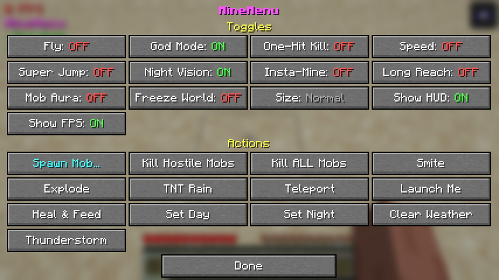
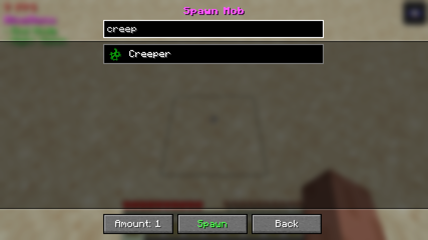

MineMenu 2.0.0 for **Minecraft Java 1.21.1** (Fabric) adds an FPS counter and a mob spawner.

## What's new

### Show FPS
A new toggle that shows your frames per second in the top-left corner. It's green at 60+, yellow at 30+ and red below that.

### Spawn Mob
Click **Spawn Mob...** to open a list of every mob in the game (82, including the hidden Giant and Illusioner).

- Search by name, then press **Enter**, double-click, or click **Spawn**.
- The mob appears on the block you're looking at, facing you.
- Spawn **1, 5 or 10** at once.
- New **Spawn Selected Mob** keybind (not bound by default) spawns your last pick without opening the menu.

### Other changes
- The menu now uses 4 columns so everything fits on screen.

## Install

1. Install the [Fabric Loader](https://fabricmc.net/use/installer/) for Minecraft **1.21.1**.
2. Put [Fabric API](https://modrinth.com/mod/fabric-api) (1.21.1) and **`minemenu-2.0.0.jar`** (below) in your `.minecraft/mods` folder. Remove the old `minemenu-1.0.0.jar`.
3. Open a singleplayer world and press **Right Shift**.

MineMenu still only works in your own singleplayer worlds. See the [README](https://github.com/peachiu/MineMenu/blob/v2.0.0/README.md) for the full feature list.
