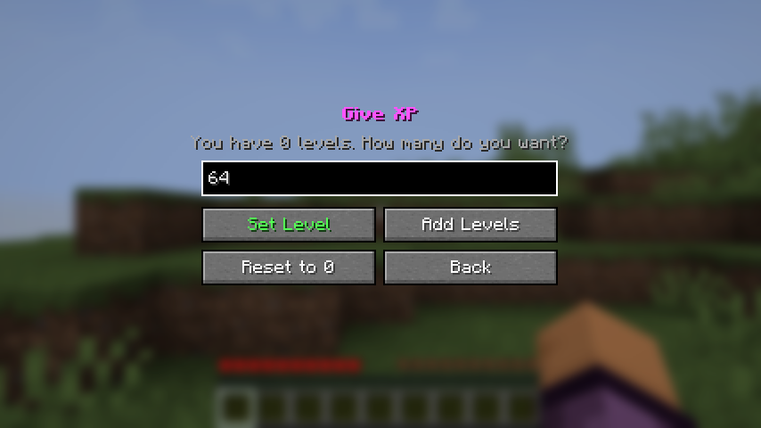

MineMenu 2.0.1 for **Minecraft Java 1.21.1** (Fabric) adds a way to give yourself XP.

## What's new

### Give XP
Click **Give XP...** in the menu, type a number of levels and press **Enter**.

- **Set Level** (or Enter): type `64` and you'll have exactly 64 levels.
- **Add Levels**: adds the number on top of the levels you already have.
- **Reset to 0**: removes all your XP.
- The box only accepts numbers, up to 100,000 levels.

## Install

1. Install the [Fabric Loader](https://fabricmc.net/use/installer/) for Minecraft **1.21.1**.
2. Put [Fabric API](https://modrinth.com/mod/fabric-api) (1.21.1) and **`minemenu-2.0.1.jar`** (below) in your `.minecraft/mods` folder. Remove any older `minemenu` jar.
3. Open a singleplayer world and press **Right Shift**.

MineMenu still only works in your own singleplayer worlds. See the [README](https://github.com/peachiu/MineMenu/blob/v2.0.1/README.md) for the full feature list.
