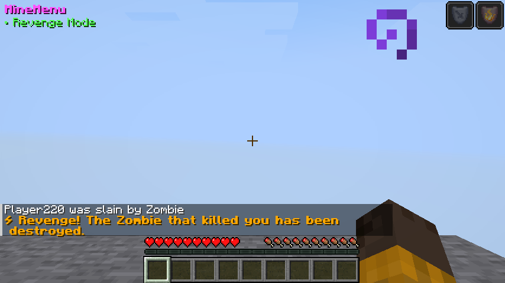

MineMenu 2.0.2 for **Minecraft Java 1.21.1** (Fabric) adds Revenge Mode.

## What's new

### Revenge Mode
A new toggle in the menu. When a mob kills you:

- ⚡ **Lightning strikes the mob that killed you and it dies.** The lightning is just for show: no fires, no damage to anything else.
- **You respawn right where you died**, next to your dropped items, instead of at your bed or the world spawn.
- You get **5 seconds of protection** (Resistance and Fire Resistance) so you don't die again straight away.
- Arrows and fireballs count: the skeleton or ghast that shot you is the one that dies. A mob that knocked you off a cliff or into lava counts too.

If you die without a mob being involved (falling on your own, drowning, `/kill`) or fall into the void, you respawn normally.

## Install

1. Install the [Fabric Loader](https://fabricmc.net/use/installer/) for Minecraft **1.21.1**.
2. Put [Fabric API](https://modrinth.com/mod/fabric-api) (1.21.1) and **`minemenu-2.0.2.jar`** (below) in your `.minecraft/mods` folder. Remove any older `minemenu` jar.
3. Open a singleplayer world and press **Right Shift**.

MineMenu still only works in your own singleplayer worlds. See the [README](https://github.com/peachiu/MineMenu/blob/v2.0.2/README.md) for the full feature list.
