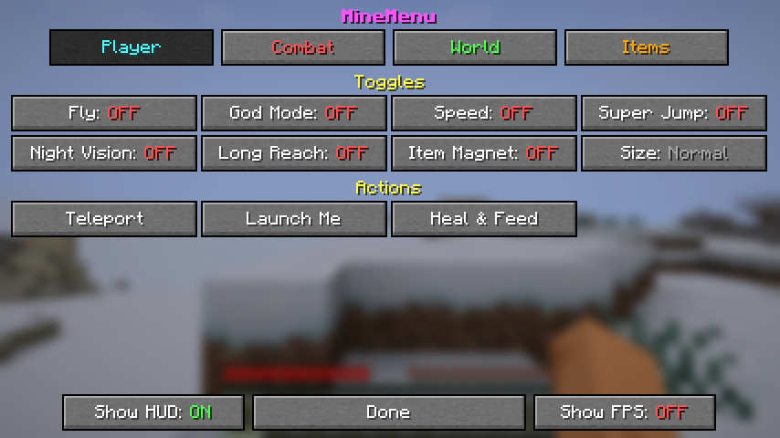

MineMenu 3.0.0 for **Minecraft Java 1.21.1** (Fabric): 13 new hacks and a menu with pages.

## New menu

The menu now has four pages: **Player**, **Combat**, **World** and **Items**. **Show HUD** and **Show FPS** are always at the bottom, next to Done.

## New hacks

**Toggles**
- **Ore Vision:** diamonds, gold, iron, emeralds, redstone, lapis and ancient debris within 20 blocks glow through walls, each in its own colour.
- **Vein Miner:** break one log or ore and the whole tree or vein comes down (Fortune and Silk Touch work). Sneak to break one block.
- **Item Magnet:** items and XP orbs within 12 blocks fly to you.
- **Mob Glow:** every mob within 64 blocks glows through walls.
- **Mega Knockback:** every mob you hit goes flying.
- **Infinite Items:** the stack in your hands never runs out, tools never break.
- **Keep Inventory:** keep your items and XP when you die.
- **Always Day:** time stops at midday, weather stays clear.

**Actions**
- **Fireball**, **Arrow Rain** (50 arrows), **Super Enchant** (every enchantment that fits, best ones win), **Repair All** and **Netherite Kit**.

## Install

1. Install the [Fabric Loader](https://fabricmc.net/use/installer/) for Minecraft **1.21.1**.
2. Put [Fabric API](https://modrinth.com/mod/fabric-api) (1.21.1) and **`minemenu-3.0.0.jar`** (below) in your `.minecraft/mods` folder. Remove the old `minemenu` jar.
3. Open a singleplayer world and press **Right Shift**.

Want the FPS boost too? Get **MineMeBoost 3.0.0** instead (don't install both). See the [README](https://github.com/peachiu/MineMenu/blob/v3.0.0/README.md) for every feature.
