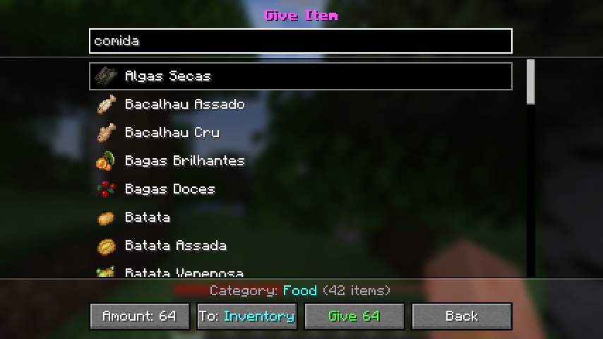

MineMenu 3.0.2 for **Minecraft Java 1.21.1** (Fabric): category search in Give Item.

## New: search by category

In **Give Item...** (Items page), type a kind of item instead of a name and you get all of them. Portuguese and English both work, with or without accents.

- `comida` / `food`: every food
- `armadura` / `roupa` / `armor`: armor you wear, plus elytra
- `capacete`, `peitoral`, `calças`, `botas`: one armor slot
- `espada`, `picareta`, `machado`, `pá`, `enxada`: that tool in every material
- `arma`, `ferramentas`, `poção`, `minério`, `ovos`, `redstone`, `blocos`, `madeira`, `flores`, `disco` and more

**Mix words to narrow it down:** `armadura diamante` gives the 4 diamond armor pieces, `espada netherite` the netherite sword. Word order doesn't matter (`sword diamond` works), and the start of a word is enough (`armad`). The line above the buttons shows what you found, e.g. *Category: Food (42 items)*.

Normal search by name still works, in your game's language or in English.

## Install

1. Install the [Fabric Loader](https://fabricmc.net/use/installer/) for Minecraft **1.21.1**.
2. Put [Fabric API](https://modrinth.com/mod/fabric-api) (1.21.1) and **`minemenu-3.0.2.jar`** (below) in your `.minecraft/mods` folder. Remove the old `minemenu` jar.
3. Join a singleplayer world, press **Right Shift**, then **Items → Give Item...**.

Want the FPS boost too? Get **MineMeBoost 3.0.2** instead (don't install both). See the [README](https://github.com/peachiu/MineMenu/blob/v3.0.2/README.md) for every feature.
