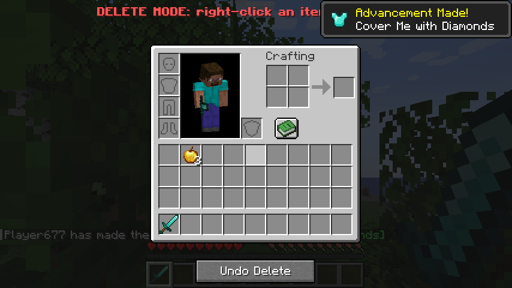

MineMenu 3.0.4.1 for **Minecraft Java 1.21.1** (Fabric): delete items with a right-click.

## New: Delete Items

A new button on the **Items** page: **Delete Items...**

- It opens your normal inventory in **delete mode** (it says so in red at the top).
- **Right-click any item to delete it**, armor and off hand included. The slot under your mouse turns red.
- **Undo Delete** gives items back one at a time, into the slot they came from (up to your last 64 deletes).
- Left-click still works as normal, so you can move things around.
- Close the inventory and it's back to normal: right-click picks up half a stack again.
- Works in creative mode too.

## Install

1. Install the [Fabric Loader](https://fabricmc.net/use/installer/) for Minecraft **1.21.1**.
2. Put [Fabric API](https://modrinth.com/mod/fabric-api) (1.21.1) and **`minemenu-3.0.4.1.jar`** (below) in your `.minecraft/mods` folder. Remove the old `minemenu` jar.
3. Join a singleplayer world, press **Right Shift**, then **Items → Delete Items...**.

Want the FPS boost too? Get **MineMeBoost 3.0.4.1** instead (don't install both). See the [README](https://github.com/peachiu/MineMenu/blob/v3.0.4.1/README.md) for every feature.
