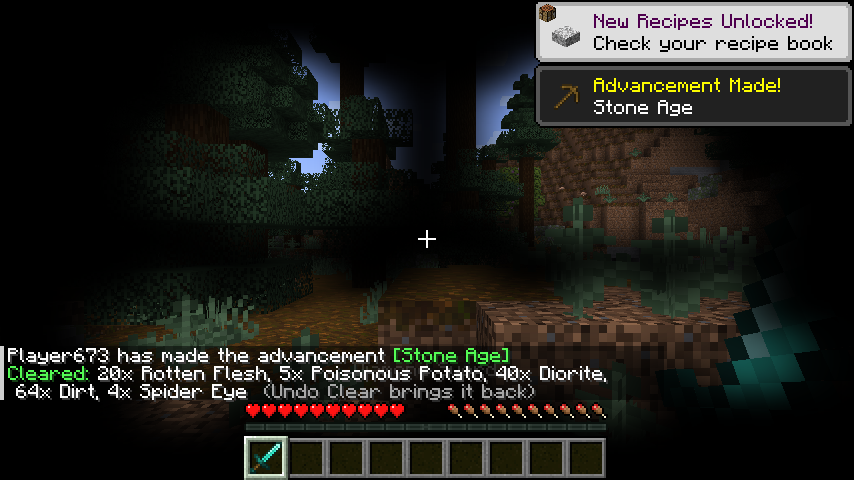

MineMenu 3.0.4 for **Minecraft Java 1.21.1** (Fabric): Clear Junk.

## New: Clear Junk and Undo Clear

Two new buttons on the **Items** page.

- **Clear Junk** deletes junk from your inventory in one click:
  - mob drops: **rotten flesh**, **poisonous potatoes**, **spider eyes**
  - mining junk: **dirt**, **gravel**, **granite**, **diorite**, **andesite**, **tuff**, **cobbled deepslate**, **netherrack**
- Your **armor** and any item you **renamed on an anvil** are never touched.
- Chat tells you exactly what was removed.
- **Undo Clear** gives back everything the last Clear Junk removed, in case you clicked it by accident.

## Install

1. Install the [Fabric Loader](https://fabricmc.net/use/installer/) for Minecraft **1.21.1**.
2. Put [Fabric API](https://modrinth.com/mod/fabric-api) (1.21.1) and **`minemenu-3.0.4.jar`** (below) in your `.minecraft/mods` folder. Remove the old `minemenu` jar.
3. Join a singleplayer world, press **Right Shift**, then **Items → Clear Junk**.

Want the FPS boost too? Get **MineMeBoost 3.0.4** instead (don't install both). See the [README](https://github.com/peachiu/MineMenu/blob/v3.0.4/README.md) for every feature.
