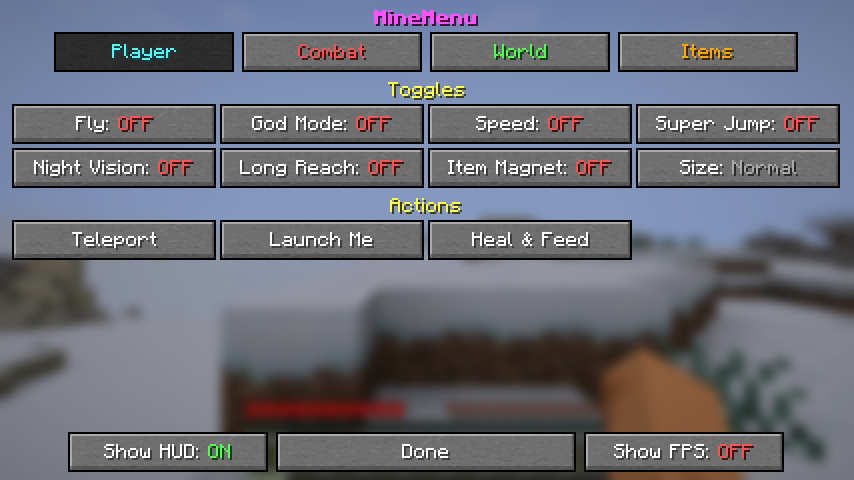
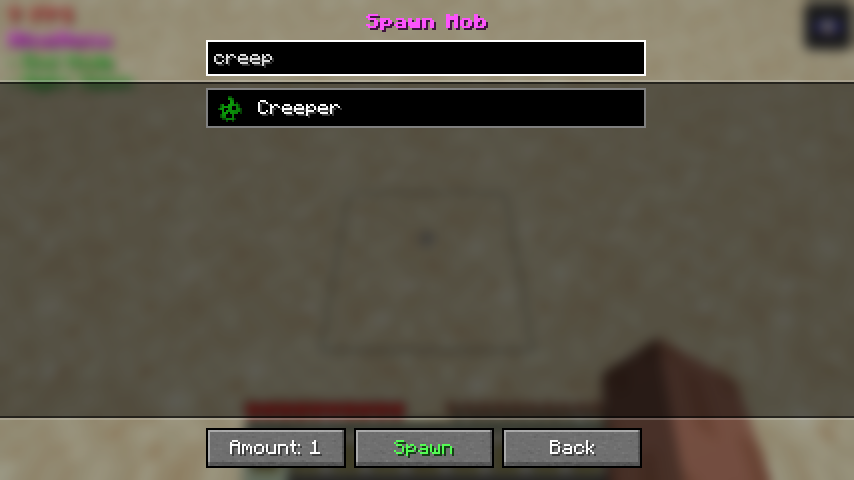
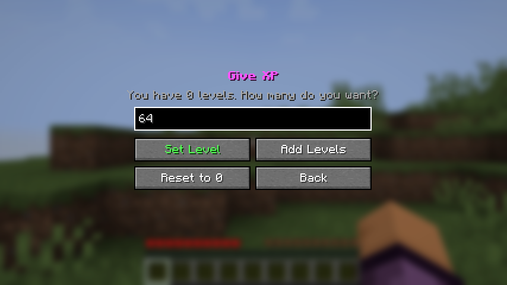

# MineMenu

A **singleplayer-only** fun menu for **Minecraft Java 1.21.1** (Fabric). Fly, god mode, X-ray style Ore Vision, Vein Miner, item magnet, one-shot mobs, spawn any mob, fireballs, arrow rain, super enchants, Revenge Mode and more. Made for messing around and filming videos.



> MineMenu only works in your own singleplayer worlds. It refuses to work on multiplayer servers, and it switches itself off if you open your world to LAN.

> **Also in this repo:**
> - **[MineBoost](mineboost/README.md)**: an FPS boost menu (press `.` in game) with one-click presets and extra boosts.
> - **[MineMeBoost](minemeboost/README.md)**: MineMenu and MineBoost in one mod, with MineMenu and MineBoost tabs on Right Shift.
>
> Each has its own jar on the [Releases page](https://github.com/peachiu/MineMenu/releases). Install only one of the three.

## Install

1. Install the [Fabric Loader](https://fabricmc.net/use/installer/) for Minecraft **1.21.1**.
2. Download [Fabric API](https://modrinth.com/mod/fabric-api) for 1.21.1 and put it in your `.minecraft/mods` folder.
3. Download `minemenu-3.0.0.jar` from the [Releases page](https://github.com/peachiu/MineMenu/releases) and put it in the same `mods` folder.
4. Start Minecraft with the Fabric 1.21.1 profile and open a singleplayer world.
5. Press **Right Shift** to open the menu.

## What's in the menu

The menu has four pages: **Player**, **Combat**, **World** and **Items**. Click a page at the top. **Show HUD** and **Show FPS** are always at the bottom, next to Done. Hover any button in the game to see what it does.

### Player

| | What it does |
|---|---|
| Fly | Creative-style flight, even in survival. Double-tap jump to take off. |
| God Mode | No damage, no hunger, no drowning, no burning. (The void and `/kill` still work so you can't get stuck.) |
| Speed | Walk and fly 3× faster. |
| Super Jump | Jump really high. No fall damage while it's on. |
| Night Vision | See in the dark and underwater. |
| Long Reach | Reach blocks and mobs from about 20 blocks away. |
| **Item Magnet** | Dropped items and XP orbs within 12 blocks fly to you. |
| Size | Cycle between Normal, **Giant** (4×) and **Tiny** (¼). |
| Teleport *(action)* | Teleports you to the block you're looking at (up to 160 blocks away). |
| Launch Me *(action)* | Shoots you into the sky. |
| Heal & Feed *(action)* | Full health and hunger. |

### Combat

| | What it does |
|---|---|
| One-Hit Kill | +1000 attack damage. Everything dies in one hit. |
| Mob Aura | Hostile mobs within 8 blocks of you die automatically. |
| **Mega Knockback** | Every mob you hit goes flying (about 25 blocks). |
| **Mob Glow** | Every mob within 64 blocks glows, so you can see it through walls. |
| Revenge Mode | If a mob kills you, lightning strikes it and it dies, and you respawn right where you died. See [Revenge Mode](#revenge-mode). |
| Kill Hostile Mobs *(action)* | Kills every hostile mob within 64 blocks. |
| Kill ALL Mobs *(action)* | Kills every mob within 64 blocks. Your tamed pets, armor stands and you are left alone. |
| Smite *(action)* | Lightning bolt where you're looking. |
| **Fireball** *(action)* | Shoots an exploding fireball where you're looking. |
| **Arrow Rain** *(action)* | 50 arrows fall from the sky where you're looking. |

### World

| | What it does |
|---|---|
| Freeze World | Freezes all mobs, projectiles, redstone and so on. You can still move around. |
| **Always Day** | Stops time at midday and keeps the weather clear. |
| **Ore Vision** | Diamonds, gold, iron, emeralds, redstone, lapis and ancient debris within 20 blocks glow through walls, each in its own colour. See [Ore Vision](#ore-vision). |
| **Vein Miner** | Break one log or ore and the whole tree or vein comes down, with your tool's Fortune or Silk Touch. Sneak to break just one block. |
| Insta-Mine | Break blocks almost instantly. |
| Spawn Mob... *(action)* | Opens a list of every mob (82 of them, including the hidden Giant and Illusioner). Search, pick one, choose 1, 5 or 10, and it spawns on the block you're looking at. |
| Explode *(action)* | TNT-sized explosion where you're looking. It breaks blocks, so turn on God Mode first. |
| TNT Rain *(action)* | Drops a ring of 12 lit TNT around you. |
| Set Day / Set Night *(actions)* | Changes the time. |
| Clear Weather / Thunderstorm *(actions)* | Changes the weather. |

### Items

| | What it does |
|---|---|
| **Infinite Items** | The stack in your hands never runs out and your tools never break. |
| **Keep Inventory** | Keep your items and XP when you die. |
| Give XP... *(action)* | Type a number of levels (for example `64`) and press Enter to have exactly that many levels. **Add Levels** adds them on top instead, and **Reset to 0** removes all your XP. |
| **Super Enchant** *(action)* | Puts every enchantment that fits on the item in your hand, at max level. When two clash, the best one wins (Sharpness, Protection, Efficiency, Fortune, Mending...). No curses. |
| **Repair All** *(action)* | Fully repairs every item in your inventory. |
| **Netherite Kit** *(action)* | A full set of super-enchanted netherite armor (worn if the slot is free), sword, pickaxe, axe, shovel, a bow and 64 arrows. |

### Ore Vision

Ore Vision places a glowing copy over every ore it finds, so the outline shows through walls. Diamonds glow aqua, emeralds green, gold yellow, iron tan, redstone red, lapis blue and ancient debris purple. Coal and copper are left out because there are far too many. It shows the 300 closest ores within 20 blocks and updates as you move and mine. The glowing copies are never saved to your world.

### Spawning mobs



1. Look at the block where you want the mob.
2. Open MineMenu and click **Spawn Mob...**.
3. Type to search (for example `creep`), then press **Enter**, double-click the mob, or click **Spawn**.

Use **Amount** to spawn 1, 5 or 10 at once. Set the **Spawn Selected Mob** keybind to spawn your last pick without opening the menu.

Hostile mobs disappear straight away on Peaceful, and Mob Aura kills them if it's on. MineMenu tells you when that happens.

### Giving yourself XP



1. Open MineMenu and click **Give XP...**.
2. Type how many levels you want, for example `64`.
3. Press **Enter** (or **Set Level**) and you'll have exactly 64 levels. Use **Add Levels** to add them to what you already have.

The box only accepts numbers, up to 100,000 levels.

### Revenge Mode


With **Revenge Mode** on, when a mob kills you:

1. Lightning strikes the mob that killed you and it dies. The lightning is just for show: it doesn't start fires or hurt anything else.
2. When you press **Respawn**, you come back right where you died, next to your dropped items, instead of at your bed or the world spawn.
3. You get 5 seconds of protection (Resistance and Fire Resistance) so you don't die again straight away.

Arrows and fireballs count: the skeleton or ghast that shot you is the one that dies. If a mob knocked you off a cliff or into lava, Minecraft still remembers it, so it dies too.

If you die without a mob being involved (falling on your own, drowning, `/kill`), you respawn normally. If you fall into the void, you respawn normally too, so you don't land back in the void.

### Keybinds

Change these in **Options → Controls → Key Binds → MineMenu**.

| Key | Default |
|---|---|
| Open MineMenu | Right Shift |
| Toggle Fly | not bound |
| Toggle God Mode | not bound |
| Kill Hostile Mobs | not bound |
| Spawn Selected Mob | not bound |

## Notes

- The menu doesn't pause the game, so you can watch things happen behind it.
- Toggles stay on when you switch worlds. Everything is undone before the world saves, so nothing sticks to your save file (no permanent flying or giant size if you remove the mod).
- Explosions and TNT break blocks. Make a backup or use a test world if you care about your build.
- **Keep Inventory** and **Always Day** change your world's game rules while they're on. Turning them off, or leaving the world, puts the old values back. If the game crashes while one is on, the rule stays changed; turn the toggle on and off again to reset it, or use `/gamerule`.

## Building

You only need this if you want to change the code. Otherwise grab the jar from [Releases](https://github.com/peachiu/MineMenu/releases).


You need **Java 21**.

```bash
./gradlew build
```

The mod jar ends up in `build/libs/minemenu-3.0.0.jar`. Ignore the `-sources.jar` file.

To try it straight from the source code, run `./gradlew runClient`.

### Making a release

1. Set `mod_version` in `gradle.properties` (for example `1.1.0`).
2. Write the release notes in `.github/release-notes/v1.1.0.md`.
3. Commit and push, then either push a matching tag (`git tag v1.1.0 && git push origin v1.1.0`) or go to **Actions → Release → Run workflow**.

GitHub Actions builds the mod, creates the tag if needed, and publishes the release with the jar attached.

## How it works (for the curious)

MineMenu is a client mod. When you play singleplayer, Minecraft runs a small server inside your game, and MineMenu makes its changes there, on your player only. That is also how it knows when you're *not* in singleplayer: there is no local server, or the server has been opened to LAN, so it does nothing.

- `MineMenuClient`: keybinds, the HUD, and hooks into the local server.
- `MineMenuScreen`: the menu.
- `MobSpawnScreen` / `MobList`: the Spawn Mob picker.
- `XpScreen`: the Give XP screen.
- `ExtraCheats`: the 3.0 hacks (Ore Vision, Vein Miner, Magnet, Mob Glow, and so on).
- `Category`: the menu pages.
- `Revenge`: Revenge Mode.
- `ServerCheats`: everything that changes the game.
- `CheatState` / `Feature`: which toggles are on.
