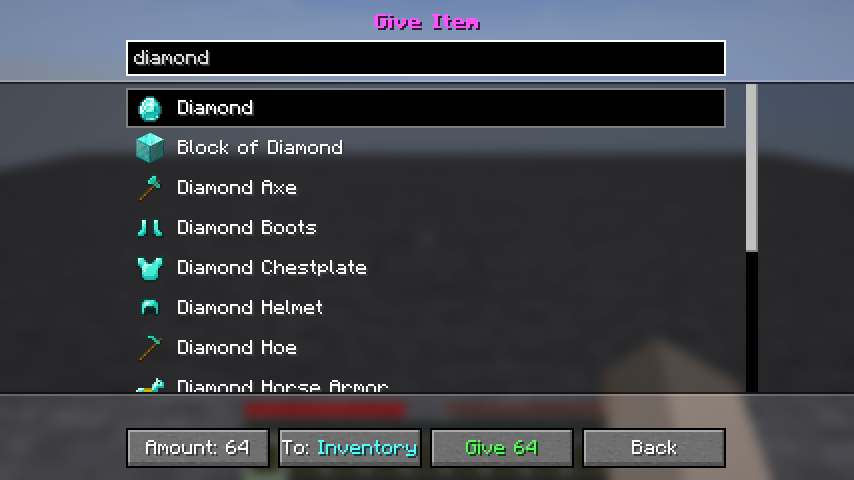
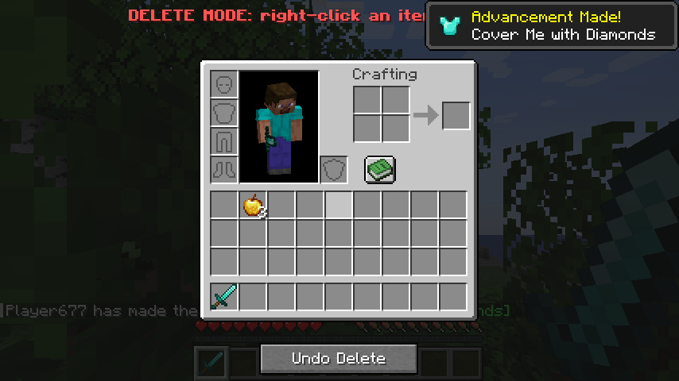
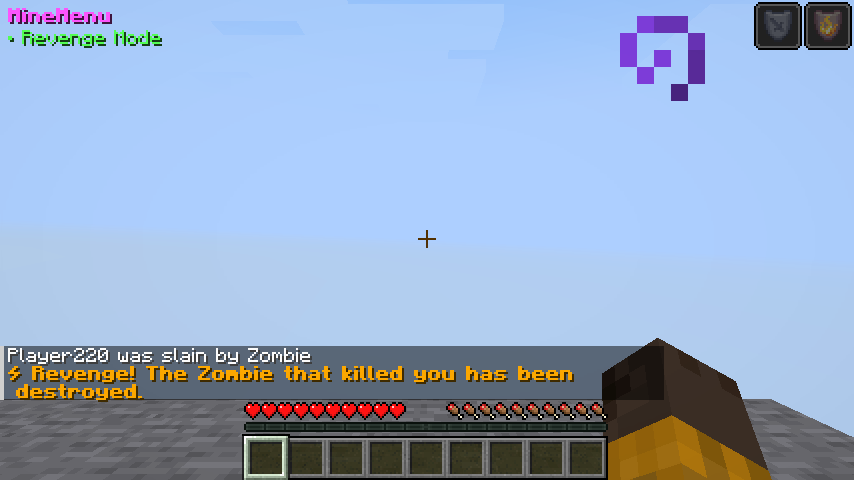

# MineMenu

A **singleplayer-only** fun menu for **Minecraft Java 1.21.1** (Fabric). Fly, noclip, god mode, zoom, tame any mob, Chest ESP, waypoints, time and weather control, a structure finder, X-ray style Ore Vision, Vein Miner, Water Walk, Spider Climb, Thor Mode, explosive arrows, auto smelt, item magnet, one-shot mobs, spawn any mob, fireballs, arrow rain, super enchants, Revenge Mode and more. Made for messing around and filming videos.


> MineMenu only works in your own singleplayer worlds. It refuses to work on multiplayer servers, and it switches itself off if you open your world to LAN.

> **Also in this repo:**
> - **[MineBoost](mineboost/README.md)**: an FPS boost menu (press `.` in game) with one-click presets and extra boosts.
> - **[MineMeBoost](minemeboost/README.md)**: MineMenu and MineBoost in one mod, with MineMenu and MineBoost tabs on Right Shift.
>
> Each has its own jar on the [Releases page](https://github.com/peachiu/MineMenu/releases). Install only one of the three.

## Install

1. Install the [Fabric Loader](https://fabricmc.net/use/installer/) for Minecraft **1.21.1**.
2. Download [Fabric API](https://modrinth.com/mod/fabric-api) for 1.21.1 and put it in your `.minecraft/mods` folder.
3. Download `minemenu-3.3.0.jar` from the [Releases page](https://github.com/peachiu/MineMenu/releases) and put it in the same `mods` folder.
4. Start Minecraft with the Fabric 1.21.1 profile and open a singleplayer world.
5. Press **Right Shift** to open the menu.

## What's in the menu

The menu has four pages: **Player**, **Combat**, **World** and **Items**. Click a page at the top. The bottom row is always there: **Show HUD**, **Enable All**, **Done** and **Show FPS**.

**Enable All** turns every ON/OFF hack on at once, on all four pages, and then changes to **Disable All**, which turns them all off again. Show HUD, Show FPS and Size aren't changed, and neither is Noclip (spectator mode would make every other hack useless). Hover any button in the game to see what it does.

### Player

| | What it does |
|---|---|
| Fly | Creative-style flight, even in survival. Double-tap jump to take off. While Fly is on, you mine just as fast in the air as on the ground (normally Minecraft makes it 5× slower). |
| God Mode | No damage, no hunger, no drowning, no burning. (The void and `/kill` still work so you can't get stuck.) |
| Speed | Walk and fly 3× faster. |
| Super Jump | Jump really high. No fall damage while it's on. |
| Night Vision | See in the dark and underwater. |
| Long Reach | Reach blocks and mobs from about 20 blocks away. |
| **Item Magnet** | Dropped items and XP orbs within 12 blocks fly to you. |
| **Water Walk** | Walk on water and lava as if they were solid ground. Sneak to sink in. |
| **Spider Climb** | Walk into a wall to climb straight up it. |
| **No Fall Damage** | Falling never hurts, from any height. |
| **Jetpack** | Hold jump to fly upwards (about 20 blocks in a second and a half), no Fly needed. No fall damage while it's on. |
| **Feather Fall** | Slow Falling: you fall about 9 times slower. |
| **Noclip** *(3.3)* | Fly through walls and the ground. This uses spectator mode (the only reliable noclip in 1.21.1): you can't break or place blocks while it's on. Turn it off and you're back in your normal game mode, right where you are. |
| **Zoom** *(3.3)* | Hold **Z** to zoom in 4× like a spyglass (the mouse turns slower too). Scroll while holding Z to zoom between 1.5× and 50×. The key can be changed in Controls. |
| **Step-Up** *(3.3)* | Walk up full blocks without jumping, like stairs. |
| **Fast Swim** *(3.3)* | Dolphin's Grace plus no slowdown when walking in water. |
| **Elytra Boost** *(3.3)* | While gliding with an elytra, hold forward to speed up, like an endless firework (about 1.5 blocks per tick). |
| **Auto-Eat** *(3.3)* | When there's room in your hunger bar, you eat the best food in your inventory by yourself, instantly. Never eats rotten flesh, spider eyes, raw chicken, pufferfish, golden apples or golden carrots. |
| **Auto-Tool** *(3.3)* | When you start breaking a block, your hotbar switches to the tool that breaks it fastest (and never to a tool with 1 durability left). |
| Size | Cycle between Normal, **Giant** (4×) and **Tiny** (¼). |
| Teleport *(action)* | Teleports you to the block you're looking at (up to 160 blocks away). |
| Launch Me *(action)* | Shoots you into the sky. |
| Heal & Feed *(action)* | Full health and hunger. |
| **Ride Mob** *(action)* | Ride the mob you're looking at (up to 32 blocks away). Sneak to get off. |
| **Waypoints...** *(3.3, action)* | Up to **5 named waypoints** per world: type a name, **Set Here**, **Go** (teleport, even to another dimension), **HUD** on/off and **Delete**. Waypoints with HUD on show their direction (an arrow) and distance in the top-left corner, plus ▲/▼ when they're above or below you. Saved in the world folder (`minemenu_waypoints.json`). |
| **Set Home** / **Go Home** *(actions)* | Quick buttons for the waypoint called **Home**. An old 3.2 Home is moved into the waypoints by itself the first time you load the world. |

### Combat

| | What it does |
|---|---|
| One-Hit Kill | +1000 attack damage. Everything dies in one hit. |
| Mob Aura | Hostile mobs within 8 blocks of you die automatically. |
| **Mega Knockback** | Every mob you hit goes flying (about 25 blocks). |
| **Stun Hits** | Every mob you hit freezes in place for 10 seconds. |
| **Thor Mode** | Every mob you hit is struck by lightning: 8 extra damage and it catches fire. The lightning never hurts you and never sets the ground on fire. |
| **Explosive Arrows** | Your arrows explode like a creeper when they hit a block or a mob. They break blocks! |
| **Mob Glow** | Every mob within 64 blocks glows, so you can see it through walls. |
| **Auto-Totem** *(3.3)* | Keeps a Totem of Undying in your off hand: when one gets used up, the next one from your inventory moves there. |
| **Tame Anything** *(3.3)* | Right-click any mob with an **empty hand** and it becomes your pet (hearts appear). It follows you (and catches up if you get far away), never attacks you, and attacks whatever you hit. Mobs that can't attack, like cows, ram the target instead. Pets stay pets after you reload the world. Sneak + right-click a pet to set it free. |
| **Always Crit** *(3.3)* | Every fully charged hit is a critical hit (1.5× damage), no jumping needed. *(This replaces the Shield Breaker idea: mobs in 1.21.1 never block with shields, so it would do nothing in singleplayer.)* |
| Revenge Mode | If a mob kills you, lightning strikes it and it dies, and you respawn right where you died. See [Revenge Mode](#revenge-mode). |
| Kill Hostile Mobs *(action)* | Kills every hostile mob within 64 blocks. |
| Kill ALL Mobs *(action)* | Kills every mob within 64 blocks. Your tamed pets, armor stands and you are left alone. |
| Smite *(action)* | Lightning bolt where you're looking. |
| **Fireball** *(action)* | Shoots an exploding fireball where you're looking. |
| **Arrow Rain** *(action)* | 50 arrows fall from the sky where you're looking. |
| **Wolf Army** *(action)* | 5 tamed wolves appear around you and fight for you. |
| **Mob Rain** *(action)* | 20 random mobs fall from the sky around you (no bosses). |
| **Resize Mob** *(action)* | The mob you're looking at becomes giant (4x), then tiny (1/4), then normal again. It stays that size. |

### World

| | What it does |
|---|---|
| Freeze World | Freezes all mobs, projectiles, redstone and so on. You can still move around. |
| **Always Day** | Stops time at midday and keeps the weather clear. |
| **Ore Vision** | Diamonds, gold, iron, emeralds, redstone, lapis and ancient debris within 20 blocks glow through walls, each in its own colour. See [Ore Vision](#ore-vision). |
| **Vein Miner** | Break one log or ore and the whole tree or vein comes down, with your tool's Fortune or Silk Touch. Sneak to break just one block. |
| Insta-Mine | Break blocks almost instantly. |
| **Auto Replant** | Harvest a fully grown crop (wheat, carrots, potatoes, beetroot, nether wart) and it plants itself again. |
| **Peace Mode** | No new mobs spawn (the doMobSpawning game rule, put back when you turn it off or leave the world). |
| **Chest ESP** *(3.3)* | Chests (orange), barrels (brown), shulker boxes (pink) and ender chests (cyan) within 32 blocks glow through walls. Ones within 4 blocks of you don't, so you can still open them normally. |
| **Growth Aura** *(3.3)* | Crops, saplings and other plants within 8 blocks get a bone meal step about every two seconds, so a field grows in seconds while you stand there. |
| **Fast Breed** *(3.3)* | Animals within 16 blocks can breed again right away, and babies grow up instantly. |
| **Auto Smelt** | Blocks you mine drop already smelted: iron, gold and copper ingots, glass, stone and more. Works with Vein Miner. |
| Spawn Mob... *(action)* | Opens a list of every mob (82 of them, including the hidden Giant and Illusioner). Search, pick one, choose 1, 5 or 10, and it spawns on the block you're looking at. |
| Explode *(action)* | TNT-sized explosion where you're looking. It breaks blocks, so turn on God Mode first. |
| TNT Rain *(action)* | Drops a ring of 12 lit TNT around you. |
| **Time & Weather...** *(3.3, action)* | A slider for the exact time (shown as a clock), Sunrise / Noon / Sunset / Midnight buttons, a **Day Speed** slider (Stopped, Normal, 2×, 5×, 10×, 20×, 60×) and Sun / Rain / Thunder. Day Speed goes back to Normal when you leave the world. |
| **Find Structure...** *(3.3, action)* | Pick a structure (village, stronghold, mansion, monument, ancient city, trial chambers, temples, outpost, witch hut, igloo, shipwreck, buried treasure, ruined portal, mineshaft, trail ruins, fortress, bastion, end city). The nearest one in your dimension (same search as `/locate`) shows up in your HUD with an arrow and the distance, and in chat with its coordinates. |
| Set Day / Set Night *(actions)* | Changes the time. |
| Clear Weather / Thunderstorm *(actions)* | Changes the weather. |
| **Grow Plants** *(action)* | Every crop, sapling, stem, berry bush, bamboo and mushroom within 8 blocks grows fully. Saplings become trees. |
| **Clear Ground Items** *(action)* | Removes every dropped item and stuck arrow within 64 blocks. Your thrown trident is left alone. |

### Items

| | What it does |
|---|---|
| **Give Item...** *(action)* | Pick any item from a searchable list with icons. Choose 1, 16, 32 or 64 (tools and armor come one at a time) and where it goes: **Inventory** (if it's full, the rest drops at your feet) or **Ground** (dropped on the block you're looking at). Press Enter, double-click or click Give; the list stays open so you can grab several things. |
| **Infinite Items** | The stack in your hands never runs out and your tools never break. |
| **Keep Inventory** | Keep your items and XP when you die. |
| **Infinite Durability** *(3.3)* | Your held items and armor never wear out. Unlike Infinite Items, stacks still get used up. |
| **Auto-Fish** *(3.3)* | Cast a fishing rod once: it reels in by itself when a fish bites and casts again half a second later. |
| **Instant Build** *(3.3)* | No delay between placing blocks: hold right-click and you place a block every tick (20 a second instead of 5). |
| *Quick Craft* | Not a hack: Minecraft already does it. **Shift-click the result** in a crafting table to craft as many as your ingredients allow. |
| Give XP... *(action)* | Type a number of levels (for example `64`) and press Enter to have exactly that many levels. **Add Levels** adds them on top instead, and **Reset to 0** removes all your XP. |
| **Super Enchant** *(action)* | Puts every enchantment that fits on the item in your hand, at max level. When two clash, the best one wins (Sharpness, Protection, Efficiency, Fortune, Mending...). No curses. |
| **Repair All** *(action)* | Fully repairs every item in your inventory. |
| **Delete Items...** *(action)* | Opens your inventory in delete mode: **right-click any item to delete it** (armor and off hand too). The slot under the mouse turns red. **Undo Delete** gives items back one by one, into the slot they came from. Left-click works as normal, and closing the inventory ends delete mode. Works in creative too. |
| **Clear Junk** *(action)* | Deletes junk from your inventory: rotten flesh, poisonous potatoes, spider eyes, dirt, gravel, granite, diorite, andesite, tuff, cobbled deepslate and netherrack. Armor and items you renamed on an anvil are never touched. Chat shows what was removed. |
| **Undo Clear** *(action)* | Gives back everything the last Clear Junk removed. |
| **Netherite Kit** *(action)* | A full set of super-enchanted netherite armor (worn if the slot is free), sword, pickaxe, axe, shovel, a bow and 64 arrows. |

### Giving yourself items



1. Open MineMenu, go to the **Items** page and click **Give Item...**.
2. Type to search (for example `diamond`, `elytra` or `totem`). The best match is picked for you.
3. Set **Amount** and **To: Inventory / Ground**, then press **Enter** (or **Give**).

**Categories:** type a kind of item instead of a name and you get all of them. Portuguese and English both work, with or without accents, and you can add words to narrow it down: `armadura diamante` gives the 4 diamond armor pieces, `espada netherite` the netherite sword.


| Type | You get |
|---|---|
| `comida`, `food` | Every food |
| `bebida`, `poção`, `potion` | Potions, milk, honey |
| `armadura`, `roupa`, `armor` | Armor you wear (and elytra) |
| `capacete`, `peitoral`, `calças`, `botas` | One armor slot |
| `espada`, `picareta`, `machado`, `pá`, `enxada` | That tool or weapon in every material |
| `arma`, `weapon` | Swords, axes, bows, crossbows, tridents, maces, arrows |
| `ferramentas`, `tools` | Everything in the creative Tools tab |
| `combate`, `blocos`, `cores`, `natureza`, `funcional`, `redstone`, `ingredientes`, `operador` | The matching creative tab |
| `minério`, `ore` | Every ore (and ancient debris) |
| `ovos`, `spawn egg` | Every spawn egg |
| `madeira`, `lã`, `cama`, `flores`, `disco`, `barco`, `carrinho`, `corante`, `cabeça`, `balde`, `livro`, `vidro` | Wood, wool, beds, flowers, music discs, boats, minecarts and rails, dyes, heads, buckets, books, glass |

The start of a word is enough too (`armad` already means armor). Normal search by name still works, in your game's language or in English.

### Deleting items



1. Open MineMenu, go to the **Items** page and click **Delete Items...**.
2. Your inventory opens with **DELETE MODE** at the top. Right-click an item to delete it.
3. Deleted something by mistake? Click **Undo Delete** (it remembers your last 64 deletes).
4. Close the inventory and everything is back to normal: right-click splits stacks again.

### Ore Vision

Ore Vision places a glowing copy over every ore it finds, so the outline shows through walls. Diamonds glow aqua, emeralds green, gold yellow, iron tan, redstone red, lapis blue and ancient debris purple. Coal and copper are left out because there are far too many. It shows the 300 closest ores within 20 blocks and updates as you move and mine. The glowing copies are never saved to your world.

### Spawning mobs


1. Look at the block where you want the mob.
2. Open MineMenu and click **Spawn Mob...**.
3. Type to search (for example `creep`), then press **Enter**, double-click the mob, or click **Spawn**.

Use **Amount** to spawn 1, 5 or 10 at once. Set the **Spawn Selected Mob** keybind to spawn your last pick without opening the menu.

Hostile mobs disappear straight away on Peaceful, and Mob Aura kills them if it's on. MineMenu tells you when that happens.

### Giving yourself XP


1. Open MineMenu and click **Give XP...**.
2. Type how many levels you want, for example `64`.
3. Press **Enter** (or **Set Level**) and you'll have exactly 64 levels. Use **Add Levels** to add them to what you already have.

The box only accepts numbers, up to 100,000 levels.

### Revenge Mode



With **Revenge Mode** on, when a mob kills you:

1. Lightning strikes the mob that killed you and it dies. The lightning is just for show: it doesn't start fires or hurt anything else.
2. When you press **Respawn**, you come back right where you died, next to your dropped items, instead of at your bed or the world spawn.
3. You get 5 seconds of protection (Resistance and Fire Resistance) so you don't die again straight away.

Arrows and fireballs count: the skeleton or ghast that shot you is the one that dies. If a mob knocked you off a cliff or into lava, Minecraft still remembers it, so it dies too.

If you die without a mob being involved (falling on your own, drowning, `/kill`), you respawn normally. If you fall into the void, you respawn normally too, so you don't land back in the void.

### Keybinds

Change these in **Options → Controls → Key Binds → MineMenu**.

| Key | Default |
|---|---|
| Open MineMenu | Right Shift |
| Toggle Fly | not bound |
| Toggle God Mode | not bound |
| Kill Hostile Mobs | not bound |
| Spawn Selected Mob | not bound |
| Zoom (hold, with the Zoom hack on) | Z |

## Notes

- The menu doesn't pause the game, so you can watch things happen behind it.
- Toggles stay on when you switch worlds. Everything is undone before the world saves, so nothing sticks to your save file (no permanent flying or giant size if you remove the mod).
- Explosions and TNT break blocks. Make a backup or use a test world if you care about your build.
- **Keep Inventory**, **Always Day** and **Peace Mode** change your world's game rules while they're on. Turning them off, or leaving the world, puts the old values back. If the game crashes while one is on, the rule stays changed; turn the toggle on and off again to reset it, or use `/gamerule`.

## Building

You only need this if you want to change the code. Otherwise grab the jar from [Releases](https://github.com/peachiu/MineMenu/releases).


You need **Java 21**.

```bash
./gradlew build
```

The mod jar ends up in `build/libs/minemenu-3.3.0.jar`. Ignore the `-sources.jar` file.

To try it straight from the source code, run `./gradlew runClient`.

### Making a release

1. Set `mod_version` in `gradle.properties` (for example `1.1.0`).
2. Write the release notes in `.github/release-notes/v1.1.0.md`.
3. Commit and push, then either push a matching tag (`git tag v1.1.0 && git push origin v1.1.0`) or go to **Actions → Release → Run workflow**.

GitHub Actions builds the mod, creates the tag if needed, and publishes the release with the jar attached.

## How it works (for the curious)

MineMenu is a client mod. When you play singleplayer, Minecraft runs a small server inside your game, and MineMenu makes its changes there, on your player only. That is also how it knows when you're *not* in singleplayer: there is no local server, or the server has been opened to LAN, so it does nothing.

- `MineMenuClient`: keybinds, the HUD, and hooks into the local server.
- `MineMenuScreen`: the menu.
- `MobSpawnScreen` / `MobList`: the Spawn Mob picker.
- `XpScreen`: the Give XP screen.
- `ItemGiveScreen`: the Give Item picker.
- `ExtraCheats`: the 3.0 hacks (Ore Vision, Vein Miner, Magnet, Mob Glow, and so on).
- `Category`: the menu pages.
- `Revenge`: Revenge Mode.
- `ServerCheats`: everything that changes the game.
- `CheatState` / `Feature`: which toggles are on.
