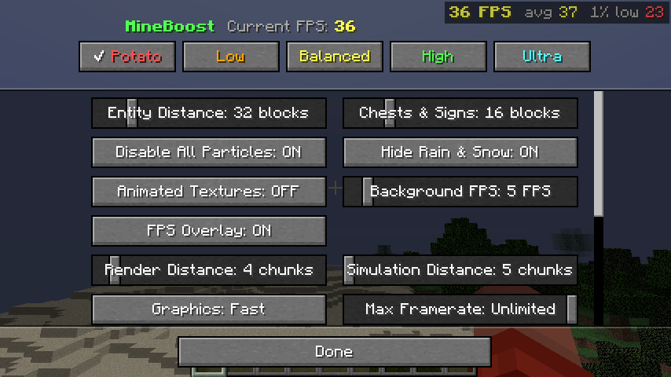
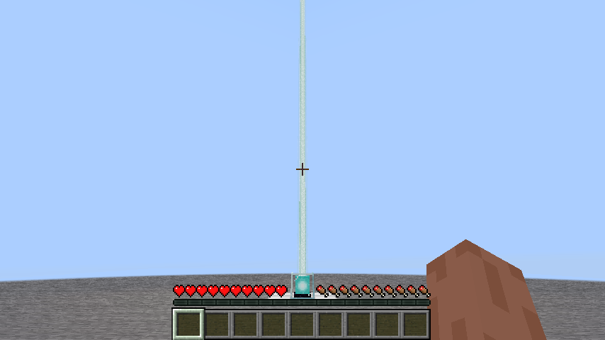
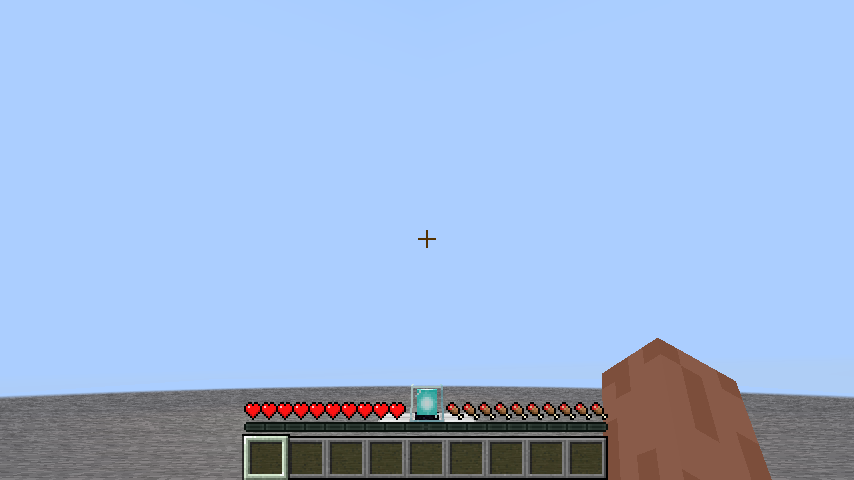
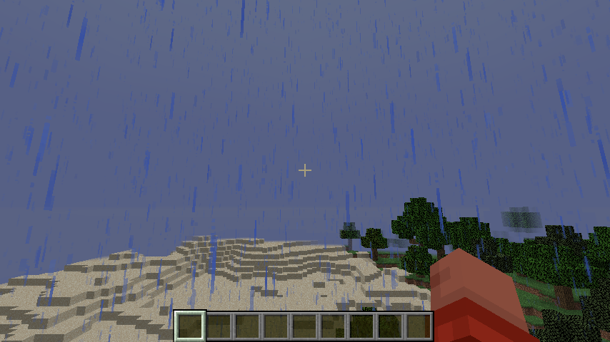
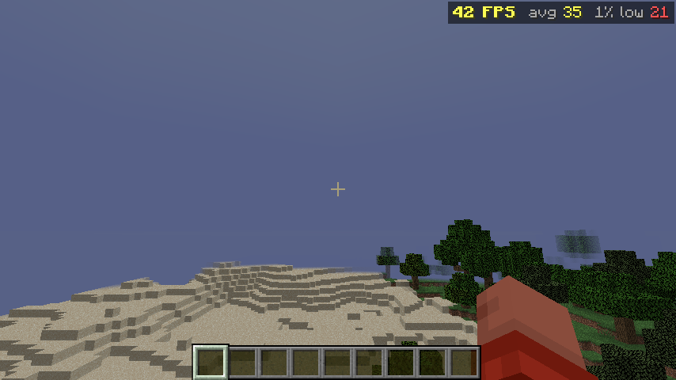

# MineBoost

An **FPS boost menu** for **Minecraft Java 1.21.1** (Fabric). Press **`.`** (period) in game to open it.



- **Sharpen (CAS)** *(2.5)*: Render Scale now stretches the picture with AMD's Contrast Adaptive Sharpening, in the same pass, so 75% looks close to 100%; Render Scale 75% with Sharpen gave **+28% FPS** in our A/B test. Strength 0-100% (50% by default; Off for maximum FPS).
- **Impostors** *(2.5)*: mobs farther than 16-64 blocks are drawn as one flat picture of themselves (photographed from 8 sides) instead of the full model with armor and items. **+11% FPS, +53% 1% low** with 150 armored mobs in view. Off by default (far mobs don't animate).
- **Presets that use your A/B results** *(2.5)*: after you run the A/B test, Toaster, Potato and Intel iGPU pick the Render Scale that really gave FPS on your PC (Toaster 50% or 75%, the others 75% or 100%); the preset's tooltip says why.
- **Render Scale** *(2.4)*: draws the world at 50-99% of your screen's resolution and scales it up, while the HUD, chat and menus stay sharp. **+15% FPS at 50%** on our test PC; most useful on integrated graphics. **Dynamic Render Scale** lowers it only when you're below your FPS target. (Off with Iris, which has its own resolution settings.)
- **Lag Doctor** *(2.4, Tools...)*: measures 10, 30 or 60 seconds and tells you what costs you FPS ("Drawing terrain 56%, Clouds 1%..."), with a one-click fix next to each finding. Frames over 50 ms are written to `config/minemeboost/spikes.log` with what was happening.
- **Tools...** *(2.4)*: **A/B test of every boost** (each one off/on twice, results in chat and in `config/minemeboost/benchmark-results.md`), **Memory panel** with a JVM Advisor (how much RAM to give Minecraft on your PC and the flags to copy), **context rules** (switch preset in the Nether, underground, while flying with an elytra...), **FPS profiles** you can share as a code, a **frame-time graph** and **Battery Saver** (30 FPS and Render Scale 70%, one key).
- **One-click presets:** Toaster, Potato, Low, **Intel iGPU**, Balanced, High and Ultra, plus **Auto Preset**, which tests them and picks the best one for your PC.
- **Simple Far Mobs** *(2.3)*: armor, held items and other extra layers aren't drawn on far-away mobs. **+31% FPS** with 98 armored mobs in view.
- **Idle Mode** *(2.3)*: lower FPS after you stop touching the keyboard and mouse (15 s to 5 min), full FPS the moment you press something.
- **Every tooltip says how much it helps** *(2.3)*: an **Impact:** line with the gain we measured. See [the measurements](docs/fps-measurements.md).
- **Works with Sodium, Lithium, FerriteCore, ImmediatelyFast and EntityCulling** *(2.3)*: MineBoost detects them, turns off its own version of anything they already do, and shows that at the top of the screen.
- **The graphics settings that matter for FPS**, all on one screen, biggest impact first.
- **Extra boosts vanilla doesn't have:** turn off all particles, hide rain and snow, limit how far mobs, chests and signs are drawn, freeze animated textures, and drop FPS when the game is in the background.
- **Smart Culling:** mobs, items, chests and signs hidden behind solid blocks aren't drawn.
- **Smart Render Distance:** pick an FPS target and MineBoost lowers or raises your render distance by itself to hold it.
- **Max Particles:** caps how many particles exist at once, so TNT and big farms don't tank your FPS.
- **Benchmark:** measures your FPS for 10 seconds and posts the average, 1% low and worst frame in chat. From 2.3 it also compares with your last run: "avg 41 → 52 (+27%)" and which settings you changed in between, so you can see what one option is worth on *your* PC.
- **FPS overlay** with average FPS and 1% low, so you can see what each setting does.

Works in singleplayer and on servers. It only changes what your own game draws.

## Install

1. Install the [Fabric Loader](https://fabricmc.net/use/installer/) for Minecraft **1.21.1**.
2. Download [Fabric API](https://modrinth.com/mod/fabric-api) for 1.21.1 and put it in your `.minecraft/mods` folder.
3. Download `mineboost-2.5.0.jar` from the [Releases page](https://github.com/peachiu/MineMenu/releases) and put it in the same `mods` folder.
4. Start Minecraft with the Fabric 1.21.1 profile, join a world and press **`.`**.

You can change the key in **Options → Controls → Key Binds → MineBoost**.

## How much faster?

It depends on your PC and on what's on screen. Measured in a test world with 150 chickens in view, on a PC with no graphics card (software rendering, so the numbers are low, but the comparison is fair):

| Preset | FPS | Compared to Ultra |
|---|---|---|
| Ultra | 5.2 | 1× |
| High | 5.2 | 1× |
| Balanced | 6.3 | 1.2× |
| Low | 12.4 | 2.4× |
| Potato | 16.8 | **3.2×** |

No mod can promise a fixed number like "50× more FPS". The biggest gains come from render distance, the graphics mode, and cutting what's drawn (entities, particles, weather). MineBoost puts all of that in one place. For even more FPS, MineBoost also works alongside [Sodium](https://modrinth.com/mod/sodium), which rewrites Minecraft's renderer.

## Presets

| | Toaster | Potato | Low | Intel iGPU | Balanced | High | Ultra |
|---|---|---|---|---|---|---|---|
| Render distance | 2 | 4 | 6 | 8 | 10 | 16 | 24 |
| Simulation distance | 5 | 5 | 6 | 6 | 8 | 12 | 16 |
| Graphics | Fast | Fast | Fast | Fast | Fancy | Fancy | Fancy |
| Smooth lighting | Off | Off | Off | On | On | On | On |
| Clouds | Off | Off | Off | Off | Fast | Fancy | Fancy |
| Particles | Minimal | Minimal | Decreased | Decreased | Decreased | All | All |
| Entity shadows | Off | Off | Off | Off | On | On | On |
| Biome blend | 0 | 0 | 1 | 1 | 2 | 3 | 5 |
| Mipmaps | 0 | 0 | 1 | 2 | 2 | 4 | 4 |
| Entity distance (vanilla %) | 50% | 50% | 75% | 75% | 100% | 100% | 150% |
| Menu blur | 0 | 0 | 0 | 0 | 3 | 5 | 5 |
| **Entity distance (MineBoost)** | 16 blocks | 32 blocks | 48 blocks | 48 blocks | 80 blocks | Unlimited | Unlimited |
| **Chests & signs** | 8 blocks | 16 blocks | 32 blocks | 40 blocks | 48 blocks | Normal | Normal |
| **Disable all particles** | On | On | Off | Off | Off | Off | Off |
| **Hide rain & snow** | On | On | On | Off | Off | Off | Off |
| **Animated textures** | Off | Off | On | On | On | On | On |
| **Background FPS** | 5 | 5 | 10 | 10 | 15 | 30 | 30 |
| **Smart Culling** | On | On | On | On | On | On | Off |
| **Max Entities** | 50 | 100 | 200 | 100 | All | All | All |
| **Item Distance** | 4 blocks | 6 blocks | 8 blocks | 8 blocks | 12 blocks | Normal | Normal |
| **Simple Items** | On | On | On | On | Off | Off | Off |
| **Particle Range** | 16 blocks | 24 blocks | 32 blocks | 32 blocks | Any | Any | Any |
| **Simple Far Mobs** | 12 blocks | 16 blocks | 24 blocks | 24 blocks | 32 blocks | Off | Off |

**Intel iGPU** is made for laptops with Intel UHD or Iris graphics (like an i3-1005G1). Integrated graphics share memory with the CPU, so the things that cost them most are full-screen effects and drawing the same thing twice: menu blur, clouds, Fancy leaves and entity shadows are off, while smooth lighting and 8 chunks stay so it still looks like Minecraft. Clouds and entity shadows are also off in Toaster and Potato. (Fog has no cost in 1.21.1, so MineBoost leaves it alone.)

Every preset also sets **Chunk Updates** to *Threaded*, so building chunks never freezes a frame. Presets don't touch Max Framerate, VSync, GUI scale or brightness, because those are personal.

The active preset gets a ✔. Change any setting afterwards and the ✔ goes away, since you now have your own mix.

## MineBoost settings

| Setting | What it does |
|---|---|
| **Render Scale** *(2.4)* | Draws the world at 50% to 99% of your window's resolution, then scales it up to the full window; the HUD, chat and menus are drawn at full resolution on top, so text stays sharp. **Upscale Filter** picks smooth or sharp pixels. Not available with Iris (shaders have their own setting) or with Fabulous graphics. |
| **Sharpen (CAS)** *(2.5)* | How much Render Scale sharpens the stretched picture (Off, 10-100%). Contrast Adaptive Sharpening: edges that are already sharp get less, so there are no halos. Only used while Render Scale is below 100%. |
| **Impostors** *(2.5)* | Mobs farther than this (16, 24, 32, 48 or 64 blocks) are drawn as a flat picture of themselves that turns towards you. Each kind of mob (type, baby, equipment, colour) is photographed once from 8 sides into a small texture; far mobs don't animate. Players, bosses, glowing, burning and ridden mobs are always drawn normally. Off with Iris. |
| **Dynamic Render Scale** *(2.4)* | Once a second: below 90% of your FPS Target (60 if off) the scale goes down 5% (10% when far below), down to **Dynamic Scale Minimum**; after 3 s above the target it goes back up, never above Render Scale. |
| **Section Culling** *(2.4)* | Skips entities in chunk sections that aren't drawn this frame. Measured: no gain on top of Smart Culling, so off by default. Not available with Sodium (it does this itself). |
| **Far Entity Ticks (beta)** *(2.4)* | Mobs more than 48 blocks away and behind you are updated on your side every 4th tick. Measured: no gain, off by default. |
| **Smooth Fog Edge** *(2.4)* | Fog starts earlier, so chunks fade in instead of popping. Looks only, no FPS cost. |
| **Max Sounds** *(2.4)* | Most sounds playing at once (16, 32 or 64). For huge farms. Not measured (no sound card on the test PC). |
| **Battery Saver** *(2.4)* | 30 FPS and Render Scale at most 70%. Has a key (not bound by default). |
| **Frame-time Graph** *(2.4)* | A small graph of the last frames under the FPS overlay; tall bars are stutters. |
| FPS Target (Smart Render Distance) | Pick 30, 45, 60, 75, 90, 120 or 144 FPS. Once a second MineBoost checks your average FPS over the last 3 seconds: below 90% of the target it lowers the render distance (by 2 if you're far below), and well above it raises it again, but never above the distance you chose and never below 4. It waits 5 seconds after each change for the chunks to reload, and only adjusts while you're playing (not in menus or alt-tabbed). With it on, the FPS overlay also shows the current render distance. |
| Smart Culling | Mobs, animals, items, chests and signs that are completely hidden behind solid blocks aren't drawn. Biggest help in caves, villages and bases. Glass, leaves, slabs and other see-through blocks never hide anything; things within 6 blocks, players, bosses, glowing mobs (Mob Glow) and Ore Vision markers are always drawn. Each answer is re-checked 10 times a second, so things pop back as soon as they come into view. |
| Max Entities | Draw only this many of the closest mobs, animals and items (25 to 400, or All). For farms and mob grinders. Players, bosses and glowing mobs are always drawn. |
| Particle Range | Particles farther away than this (8 to 64 blocks) aren't created at all. |
| Item Distance | Dropped items farther than 4, 6, 8 or 12 blocks aren't drawn. (Minecraft already stops at about 16 blocks.) |
| **Simple Far Mobs** *(2.3)* | Mobs farther than 12 to 48 blocks are drawn without armor, held items, saddles, heads, stuck arrows and other extra layers (each one draws the mob a second time). Sheep wool, glowing eyes, the slime's outer body and charged creepers are kept, and players always look normal. Measured: **+31% FPS, +48% 1% low** with 98 armored zombies in view. |
| **Idle Mode** *(2.3)* | After **Idle After** (15 s, 30 s, 1, 2 or 5 min) without any key, click, scroll or mouse movement, FPS is limited to 5, 10, 15 or 30. Anything you press brings full FPS back on the next frame. Off by default (it would get in the way if you record without touching anything). |
| Simple Items | A dropped stack is drawn as 1 item instead of a pile of up to 5. |
| Menu FPS | FPS limit (30 or 60) while an inventory, chest or the pause menu is open. Your PC runs cooler and quieter; it doesn't change FPS while playing. Chat isn't limited. |
| Hide Sky | No sky, sun, moon or stars; the background is the fog colour. |
| Hide Beacon Beams | The beacon works, its beam isn't drawn. |
| Hide Decorations | Armor stands, item frames and paintings aren't drawn. |
| Hide Name Tags | No names above players and named mobs. |
| Hide Vignette | No dark shading at the screen edges. A small saving. |
| Max Particles | Most particles on screen at once: 250, 500, 1000, 2000, 4000 or Unlimited. Normal particles still show; huge bursts get cut off. From 2.3 the **closest particles win**: at the limit, particles near you still appear and the farthest ones are removed first. |
| Entity Distance | Mobs, animals, dropped items and item frames farther than this aren't drawn. Players, the Ender Dragon and the Wither are always drawn. One of the biggest boosts near farms and mob grinders. |
| Chests & Signs | Chests, signs, banners, heads and beds farther than this aren't drawn. Great for big bases and storage rooms. |
| Disable All Particles | No particles at all, including ones already on screen. Stronger than vanilla's Particles: Minimal. |
| Hide Rain & Snow | Rain and snow aren't drawn. It still rains in the world (crops grow, fires go out); you just don't see it. |
| Animated Textures | Off freezes water, lava, fire and portal animations. Small boost. |
| Background FPS | FPS limit when Minecraft isn't the window you're using. Minimized always drops to 1 FPS. Frees your PC for OBS, Discord or your browser. |
| FPS Overlay | FPS, average FPS and 1% low in the top-right corner. The 1% low shows how bad the stutters are. |

**Auto Preset** is the first button at the bottom. It closes the menu and tries the presets from Ultra down, about 7 seconds each (3 to let the chunks reload, 4 to measure), and keeps the best looking one that reaches your FPS Target (or 60 FPS if FPS Target is off). The result is posted in chat. Keep playing normally while it runs.

**Benchmark (10s)** is the button next to Done. It closes the menu and measures your FPS for 10 seconds while you play normally, then posts the average FPS, 1% low and worst frame in chat, with your preset and render distance. Run it with different presets to see which one suits your PC.

| Hide Beacon Beams off | Hide Beacon Beams on |
|---|---|
|  |  |

Settings are saved to `config/mineboost.json`. Vanilla settings are saved to `options.txt` as usual.

| Rain on | Hide Rain & Snow + FPS Overlay |
|---|---|
|  |  |

## Works with other performance mods *(2.3)*

When the game starts, MineBoost checks for **Sodium, Lithium, FerriteCore, ImmediatelyFast** and **EntityCulling**. If it finds any, the MineBoost screen says so under the presets ("Works with: Sodium, EntityCulling (1 MineBoost option off, hover)"), and:

- **EntityCulling** already hides things behind walls on its own thread, so **Smart Culling** is switched off and greyed out (hover it to see why), instead of both mods doing the same work.
- **Sodium** replaces the chunk renderer, so the vanilla **Chunk Builder** setting (which Sodium ignores) is hidden.
- **Lithium, FerriteCore, ImmediatelyFast**: no overlap with MineBoost (game logic, memory, HUD drawing), so nothing changes.

MineBoost's mixin plugin (`MineBoostMixinPlugin`) can also skip a whole mixin when a given mod is present, so a future conflict is turned off instead of crashing the game.

With **Iris** installed, Render Scale is switched off (shaders have their own resolution settings); with **Sodium**, Section Culling is (Sodium already does it). Tested with all of them plus Mod Menu at once *(2.4)*.

## How each setting was measured

See [docs/fps-measurements.md](docs/fps-measurements.md): the scene, the method (each option off/on two or three times) and every result, including the ones that showed **no** gain (2.4: Section Culling, Far Entity Ticks; 2.3: Smooth Chunk Loading, Animation LOD, Fog off). Options with no measured gain are off by default.

Your config from 2.2 or 2.3 loads as before; new options get their defaults (`configVersion` in `config/mineboost.json`).

## Building

You need **Java 21**.

```bash
cd mineboost
./gradlew build
```

The jar ends up in `mineboost/build/libs/mineboost-2.5.0.jar`.

### Making a release

1. Set `mod_version` in `mineboost/gradle.properties`.
2. Write the release notes in `mineboost/release-notes/v<version>.md`.
3. Commit and push, then go to **Actions → Release MineBoost → Run workflow**. It creates the tag `mineboost-v<version>` and publishes the jar.
