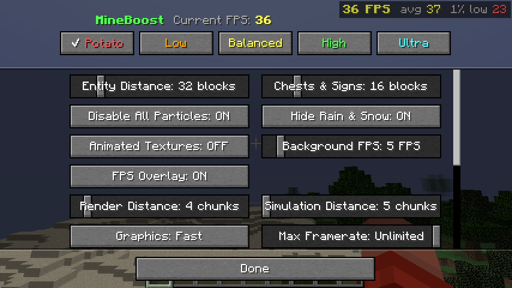

The first release of **MineBoost**: an FPS boost menu for **Minecraft Java 1.21.1** (Fabric). Press **`.`** (period) in game to open it.

## Features

- **One-click presets:** Potato, Low, Balanced, High and Ultra. The active one gets a ✔.
- **The graphics settings that matter for FPS** on one screen: render and simulation distance, graphics mode, max framerate, VSync, chunk updates, smooth lighting, clouds, particles, shadows, entity distance, biome blend, mipmaps and menu blur.
- **Extra boosts vanilla doesn't have:**
  - **Entity Distance:** mobs, items and item frames farther than this aren't drawn.
  - **Chests & Signs:** chests, signs, banners and heads farther than this aren't drawn.
  - **Disable All Particles:** stronger than vanilla's Minimal.
  - **Hide Rain & Snow:** it still rains in the world; you just don't see it.
  - **Animated Textures:** freeze water, lava and fire animations.
  - **Background FPS:** caps FPS when you alt-tab away (1 FPS when minimized).
- **FPS Overlay:** FPS, average and 1% low in the top-right corner.

## How much faster?

In a test world with 150 chickens in view, **Potato ran 3.2× faster than Ultra** (16.8 vs 5.2 FPS, measured with software rendering, so absolute numbers are low). Your gain depends on your PC and on what's on screen. MineBoost also works alongside Sodium for even more FPS.

## Install

1. Install the [Fabric Loader](https://fabricmc.net/use/installer/) for Minecraft **1.21.1**.
2. Put [Fabric API](https://modrinth.com/mod/fabric-api) (1.21.1) and **`mineboost-1.0.0.jar`** (below) in your `.minecraft/mods` folder.
3. Join a world and press **`.`**.

Works in singleplayer and on servers. See the [README](https://github.com/peachiu/MineMenu/blob/mineboost-v1.0.0/mineboost/README.md) for the full preset table.
