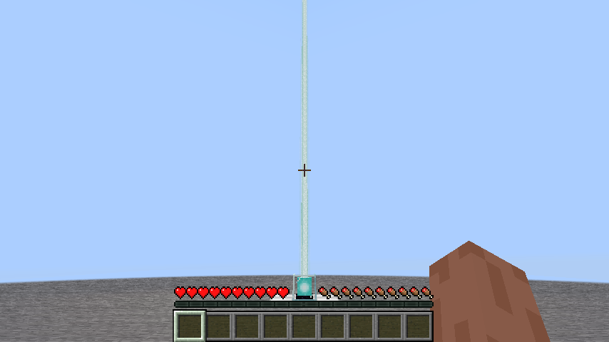
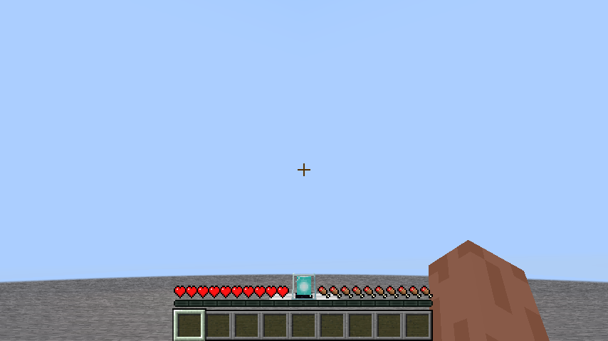

MineBoost 2.2.0 for **Minecraft Java 1.21.1** (Fabric): 10 new FPS settings.

## 10 new FPS settings

- **Max Entities:** only the closest mobs are drawn (great at farms).
- **Particle Range:** far-away particles aren't created.
- **Item Distance:** dropped items farther than 4 to 12 blocks aren't drawn.
- **Simple Items:** a dropped stack is drawn as 1 item instead of up to 5.
- **Hide Decorations:** armor stands, item frames and paintings.
- **Hide Beacon Beams**, **Hide Sky**, **Hide Name Tags**, **Hide Vignette**.
- **Menu FPS:** lower FPS while a menu is open, so your PC runs cooler (it doesn't change FPS while playing).

The Toaster, Potato, Low and Balanced presets now use Max Entities, Item Distance, Simple Items and Particle Range too.

| Hide Beacon Beams off | on |
|---|---|
|  |  |

## Install

1. Install the [Fabric Loader](https://fabricmc.net/use/installer/) for Minecraft **1.21.1**.
2. Put [Fabric API](https://modrinth.com/mod/fabric-api) (1.21.1) and **`mineboost-2.2.0.jar`** (below) in your `.minecraft/mods` folder. Remove the old `mineboost` jar.
3. Join a world and press **`.`**.

Want MineMenu too? Get **MineMeBoost 3.2.0** instead (don't install both).
