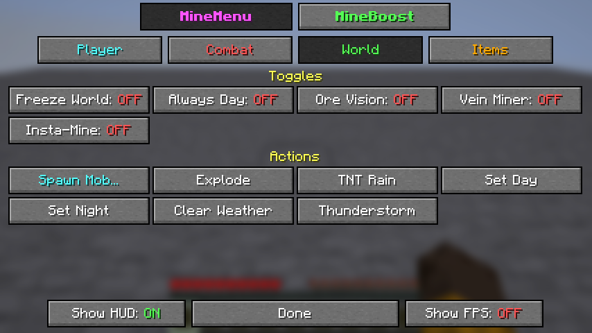
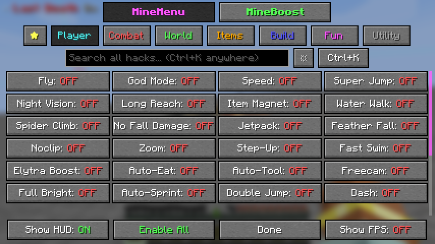
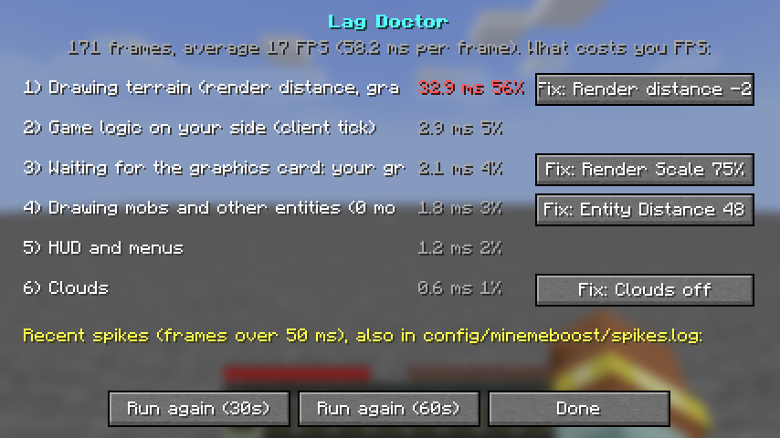
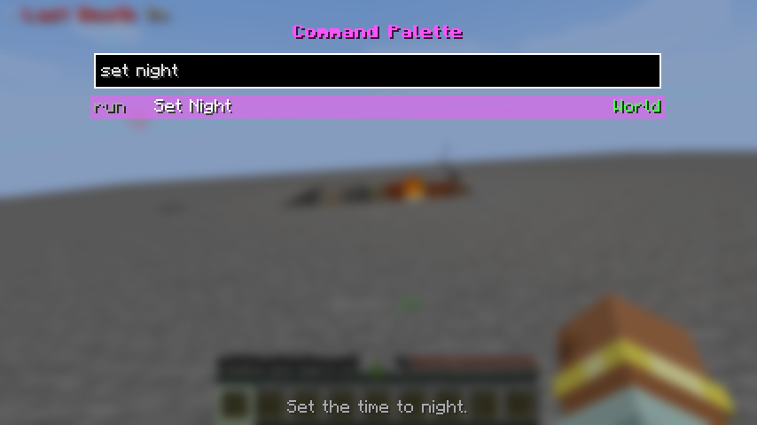
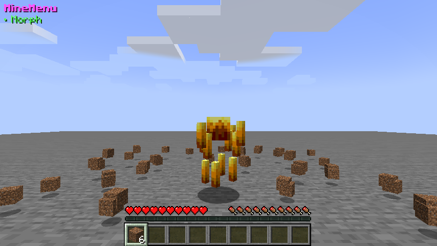

# MineMeBoost

**[MineMenu](../README.md) and [MineBoost](../mineboost/README.md) in one mod**, for **Minecraft Java 1.21.1** (Fabric).

Press **Right Shift** and the menu has two tabs at the top:

| MineMenu tab | MineBoost tab |
|---|---|
|  |  |

- **MineMenu:** hacks for your own worlds on a Favorites page and seven pages (Player, Combat, World, Items, **Build**, **Fun**, **Utility**), with search, right-click settings for every hack, a key for any hack, profiles you can share, a **Command Palette (Ctrl+K)** and themes. New in 3.4: Freecam, Morph, Phase, Double Jump, Dash, Scaffold, Lava Swim, Gravity Control, Full Bright, Remote Chest, Bow Aimbot, Lifesteal, Force Field, Thorns Aura, Mind Control, Trident Storm, Mob War, Boss Arena, Armor Loadouts, Item/Potion/Mob Creator, Inventory Snapshots, Death Chest, copy/paste with preview, schematics, instant structures, terrain brush, biome painter, gravity gun, Chaos Mode, Lucky Blocks, challenges, meteors, a tornado, a minimap with a big map, Info HUD, light levels, chunk borders, slime chunks, mob health bars and macros. Plus everything from 3.3 (fly, god mode, noclip, zoom, Ore Vision, Chest ESP, waypoints, time & weather, give item...).
- **MineBoost:** FPS boost. New in 2.4 (in 3.4): **Render Scale** (sharp HUD, +15% FPS at 50% on our test PC) and Dynamic Render Scale, the **Lag Doctor**, a spike log, an **A/B test of every boost**, a Memory panel with JVM Advisor, context rules, shareable FPS profiles, a frame-time graph and Battery Saver. Plus presets, Auto Preset, Simple Far Mobs, Smart Culling, Smart Render Distance, Max Particles, the benchmark and more.
- **New in 3.5:** sharpening (CAS) for Render Scale, Impostors for far mobs, presets that use your own A/B results, a schematics browser with previews, Undo for vanilla structures, and the whole mod in **Portuguese (Portugal)**.
- **Safe Mode:** a hack that throws an error is switched off with a message in the corner instead of crashing the game; if the game fails to start twice in a row, the next start keeps every hack off.

| The menu (3.4) | Lag Doctor |
|---|---|
|  |  |

| Command Palette (Ctrl+K) | Minimap, Info HUD, chunk borders, slime chunks, light levels |
|---|---|
|  |  |

| Morph (blaze) | Boss Arena |
|---|---|
|  |  |

| Ore Vision | Benchmark result |
|---|---|
|  |  |

Right Shift reopens the tab you used last. **`.`** still opens MineBoost directly.

### One FPS counter at a time

MineMenu's **Show FPS** and MineBoost's **FPS Overlay** can't both be on. While one is on, the other is greyed out; hover it to see why. Turn the first one off and the other unlocks.

| FPS Overlay greyed out (Show FPS is on) | Show FPS greyed out (FPS Overlay is on) |
|---|---|
|  |  |

MineMenu's hacks work in your own worlds: singleplayer, and a world you open to LAN (only for you, the host). On a multiplayer server the MineMenu tab opens but says "Cheats only work in singleplayer": only the Minimap (without mobs), Info HUD and Chunk Borders work there, and nothing is ever sent to the server. MineBoost works everywhere. With **Mod Menu** installed, MineMeBoost's config button opens this menu.

## Install

1. Install the [Fabric Loader](https://fabricmc.net/use/installer/) for Minecraft **1.21.1**.
2. Download [Fabric API](https://modrinth.com/mod/fabric-api) for 1.21.1 and put it in your `.minecraft/mods` folder.
3. Download `minemeboost-3.5.0.jar` from the [Releases page](https://github.com/peachiu/MineMenu/releases) and put it in the same `mods` folder.
4. **Remove `minemenu-*.jar` and `mineboost-*.jar`** if you have them. MineMeBoost already contains both, and Fabric will refuse to start with both installed.

Your MineBoost settings (`config/mineboost.json`) carry over from 3.2 and 3.3. MineMenu's settings, favorites, keys and profiles are saved in `config/minemeboost/cheats.json`; **⚙ → Reset everything** makes a backup first.

## Features

Everything from both mods is here. See the [MineMenu README](../README.md) and the [MineBoost README](../mineboost/README.md) for the full lists.

## Building

MineMeBoost builds straight from the code of both mods (no copies), plus the small tab code in `minemeboost/src`. You need **Java 21**.

```bash
cd minemeboost
./gradlew build
```

The jar ends up in `minemeboost/build/libs/minemeboost-3.5.0.jar`.

In-game tests (Fabric GameTest, run on a server with the mod loaded):

```bash
./gradlew runGametest
```

### In-game test suite *(3.5)*

`src/clienttest` is a small test mod (never part of a release) that drives a real Minecraft client with the real MineMeBoost jar: it creates a world, uses every hack, tool and screen, takes screenshots and writes PASS/FAIL lines. It needs Xvfb on Linux (`sudo apt install xvfb`).

```bash
./gradlew runClientTests -Psuite=full            # everything once, about 10 minutes
./gradlew runClientTests -Psuite=soak -Pminutes=60   # Chaos Mode, Minimap, ESP, Impostors... for an hour
./gradlew runClientTests -Psuite=full -PextraMods=/path/to/sodium-and-friends   # with other mods
```

Results go to `build/clienttest-run-<suite>/clienttest/`, screenshots to `build/clienttest-run-<suite>/screenshots/`, and the build fails if a check fails. On GitHub, **Actions → In-game tests** runs the full suite and a 15/30/60-minute soak test on demand, and every Monday (60 minutes).

### Making a release

1. Set `mod_version` in `minemeboost/gradle.properties`.
2. Write the release notes in `minemeboost/release-notes/v<version>.md`.
3. Commit and push, then go to **Actions → Release MineMeBoost → Run workflow**. It creates the tag `minemeboost-v<version>` and publishes the jar.
