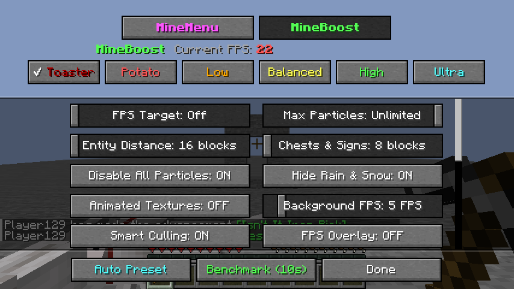
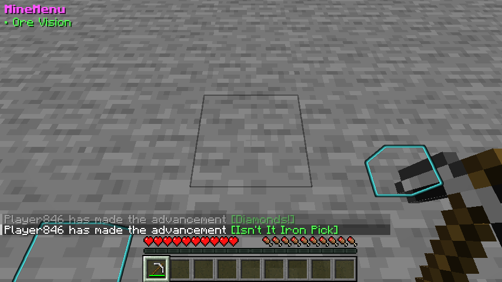
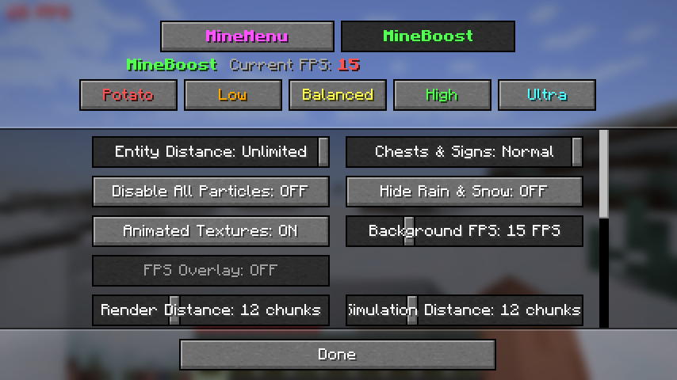
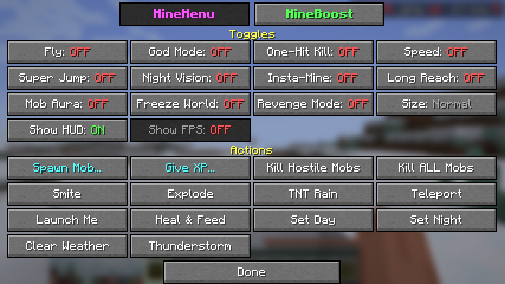

# MineMeBoost

**[MineMenu](../README.md) and [MineBoost](../mineboost/README.md) in one mod**, for **Minecraft Java 1.21.1** (Fabric).

Press **Right Shift** and the menu has two tabs at the top:

| MineMenu tab | MineBoost tab |
|---|---|
|  |  |

- **MineMenu:** singleplayer hacks on four pages (Player, Combat, World, Items): fly, god mode, Ore Vision, Vein Miner, Item Magnet, Mob Glow, Mega Knockback, Infinite Items, Keep Inventory, Always Day, fireballs, arrow rain, Give Item (any item, to your inventory or the ground, with category search like "comida" or "armadura"), Super Enchant, Netherite Kit, spawn any mob, give XP, Revenge Mode and more.
- **MineBoost:** FPS boost: Potato/Low/Balanced/High/Ultra presets, Smart Render Distance (holds an FPS target by itself), Max Particles, a 10-second benchmark, the graphics settings that matter, extra boosts and an FPS overlay.

| Ore Vision | Benchmark result |
|---|---|
|  |  |

Right Shift reopens the tab you used last. **`.`** still opens MineBoost directly.

### One FPS counter at a time

MineMenu's **Show FPS** and MineBoost's **FPS Overlay** can't both be on. While one is on, the other is greyed out; hover it to see why. Turn the first one off and the other unlocks.

| FPS Overlay greyed out (Show FPS is on) | Show FPS greyed out (FPS Overlay is on) |
|---|---|
|  |  |

MineMenu only works in your own singleplayer worlds. On a server, Right Shift opens MineBoost and the MineMenu tab is greyed out. MineBoost works everywhere.

## Install

1. Install the [Fabric Loader](https://fabricmc.net/use/installer/) for Minecraft **1.21.1**.
2. Download [Fabric API](https://modrinth.com/mod/fabric-api) for 1.21.1 and put it in your `.minecraft/mods` folder.
3. Download `minemeboost-3.0.2.jar` from the [Releases page](https://github.com/peachiu/MineMenu/releases) and put it in the same `mods` folder.
4. **Remove `minemenu-*.jar` and `mineboost-*.jar`** if you have them. MineMeBoost already contains both, and Fabric will refuse to start with both installed.

Your MineBoost settings (`config/mineboost.json`) carry over.

## Features

Everything from both mods is here. See the [MineMenu README](../README.md) and the [MineBoost README](../mineboost/README.md) for the full lists.

## Building

MineMeBoost builds straight from the code of both mods (no copies), plus the small tab code in `minemeboost/src`. You need **Java 21**.

```bash
cd minemeboost
./gradlew build
```

The jar ends up in `minemeboost/build/libs/minemeboost-3.0.2.jar`.

### Making a release

1. Set `mod_version` in `minemeboost/gradle.properties`.
2. Write the release notes in `minemeboost/release-notes/v<version>.md`.
3. Commit and push, then go to **Actions → Release MineMeBoost → Run workflow**. It creates the tag `minemeboost-v<version>` and publishes the jar.
