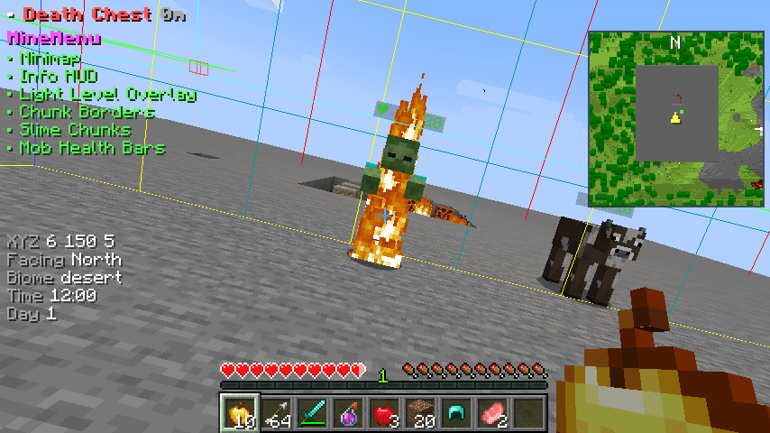
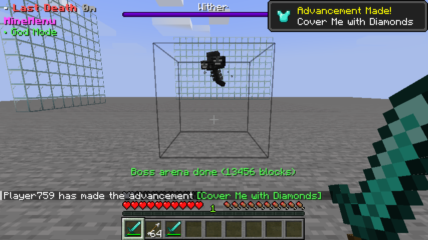
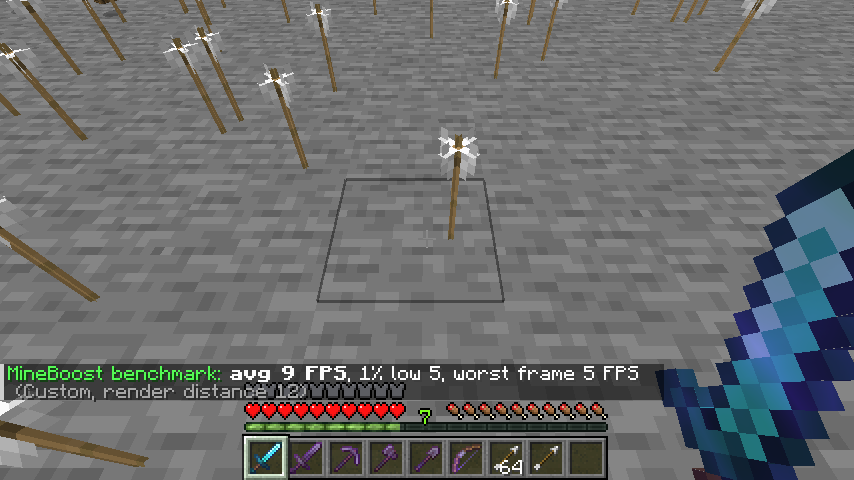
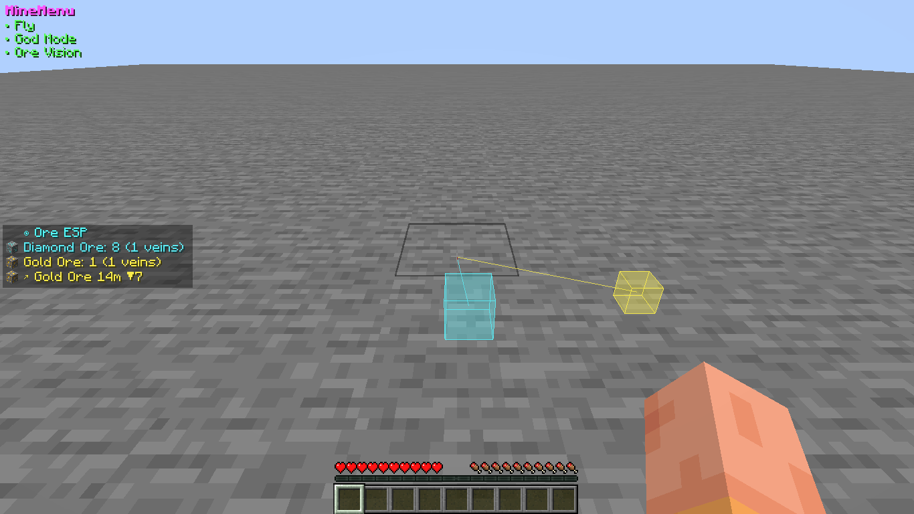
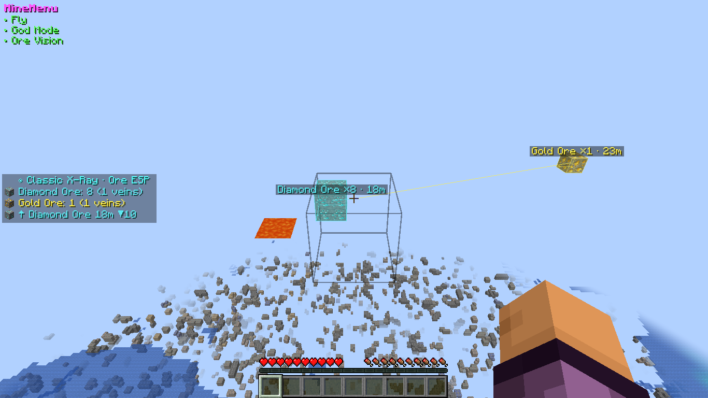
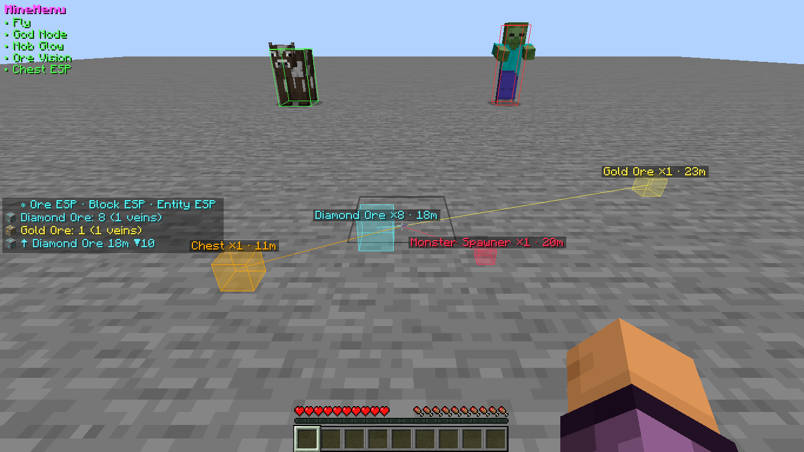
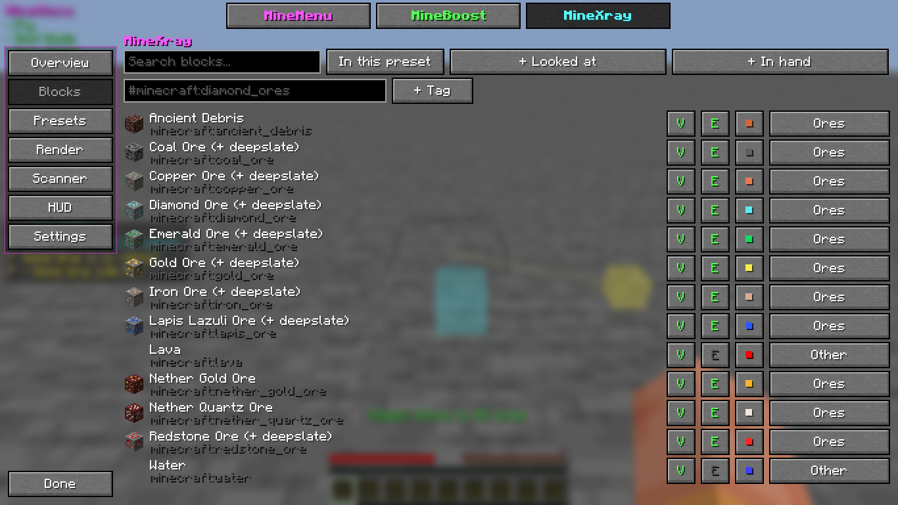

# MineMeBoostXray

**[MineMenu](../README.md), [MineBoost](../mineboost/README.md) and MineXray in one mod**, for **Minecraft Java 1.21.1** (Fabric).
(Until 3.5 it was called MineMeBoost; the mod id is still `minemeboost`, so your settings, worlds and keys stay.)

Press **Right Shift** and the menu has three tabs at the top: MineMenu, MineBoost and **MineXray** (new in 3.6, see [below](#minexray-new-in-36)).

| MineMenu tab | MineBoost tab |
|---|---|
|  |  |

- **MineMenu:** hacks for your own worlds on a Favorites page and seven pages (Player, Combat, World, Items, **Build**, **Fun**, **Utility**), with search, right-click settings for every hack, a key for any hack, profiles you can share, a **Command Palette (Ctrl+K)** and themes. New in 3.4: Freecam, Morph, Phase, Double Jump, Dash, Scaffold, Lava Swim, Gravity Control, Full Bright, Remote Chest, Bow Aimbot, Lifesteal, Force Field, Thorns Aura, Mind Control, Trident Storm, Mob War, Boss Arena, Armor Loadouts, Item/Potion/Mob Creator, Inventory Snapshots, Death Chest, copy/paste with preview, schematics, instant structures, terrain brush, biome painter, gravity gun, Chaos Mode, Lucky Blocks, challenges, meteors, a tornado, a minimap with a big map, Info HUD, light levels, chunk borders, slime chunks, mob health bars and macros. Plus everything from 3.3 (fly, god mode, noclip, zoom, Ore Vision, Chest ESP, waypoints, time & weather, give item...).
- **MineBoost:** FPS boost. New in 2.4 (in 3.4): **Render Scale** (sharp HUD, +15% FPS at 50% on our test PC) and Dynamic Render Scale, the **Lag Doctor**, a spike log, an **A/B test of every boost**, a Memory panel with JVM Advisor, context rules, shareable FPS profiles, a frame-time graph and Battery Saver. Plus presets, Auto Preset, Simple Far Mobs, Smart Culling, Smart Render Distance, Max Particles, the benchmark and more.
- **New in 3.5:** sharpening (CAS) for Render Scale, Impostors for far mobs, presets that use your own A/B results, a schematics browser with previews, Undo for vanilla structures, and the whole mod in **Portuguese (Portugal)**.
- **Safe Mode:** a hack that throws an error is switched off with a message in the corner instead of crashing the game; if the game fails to start twice in a row, the next start keeps every hack off.

| The menu (3.4) | Lag Doctor |
|---|---|
|  |  |

| Command Palette (Ctrl+K) | Minimap, Info HUD, chunk borders, slime chunks, light levels |
|---|---|
|  |  |

| Morph (blaze) | Boss Arena |
|---|---|
|  |  |

| Ore Vision | Benchmark result |
|---|---|
|  |  |

## MineXray *(new in 3.6)*

X-ray and ESP for **singleplayer** (and LAN worlds you host). On a multiplayer server every MineXray mode is off, the tab says "MineXray only works in singleplayer", and nothing is scanned, drawn or sent.

| Ore ESP: whole veins, labels, tracers | Classic X-Ray |
|---|---|
|  |  |

| Block ESP + Entity ESP | The MineXray tab (block editor) |
|---|---|
|  |  |

**Modes** (several at once, each with its own key in Options > Controls > Key Binds > MineXray):

- **Classic X-Ray** (key **X**): hides everything except the preset's *Visible* blocks (ores, lava...), with full brightness and no smooth-lighting shadows while on. Hidden blocks can be drawn see-through (opacity 0-100%). Chunks are rebuilt once when you switch it or change the list ("Rebuilding chunks..." shows meanwhile); everything is put back when you switch it off. *Not available with Sodium* (it replaces the chunk builder this mode changes): you get the message "Classic X-Ray isn't available with Sodium, use Ore ESP".
- **Ore ESP** (key **G**): the preset's blocks through walls, without rebuilding chunks. Touching blocks of the same kind are drawn as **one vein** (no lines inside). Styles: outline, filled box, outline + fill, corners only. Colour per block, line thickness, opacity, fade with distance, **tracers** to the 10 nearest veins, **labels** ("Diamond Ore ×6 · 14m"), radius 8-128 (32 by default), a block limit (2000, nearest first).
- **Cave Finder**: caves and ravines below a height you choose (cave air), as dots or an outline; optionally only large caves. *Dungeons are made of normal air, so they show through Block ESP's spawner category instead.*
- **Fluid View**: lava in orange (and water in blue, if you want), with its own radius.
- **Lava Warning**: a warning and a low note when there's lava up to 3 blocks behind or under the block you're mining. Works with the other modes off.
- **Block ESP**: storage, spawners and trial spawners, vaults, portals, budding amethyst, suspicious sand/gravel, sculk sensors/shriekers, redstone (off by default), infested blocks; each category with a switch and a colour.
- **Entity ESP**: boxes around mobs through walls (hostile red, passive green, players blue, items yellow), its own radius, outline or box. It replaces Mob Glow.

**Block editor:** every block in the game (modded too) with search, icon, name and id; per block: kept in Classic, shown by ESP, colour, category. Add by search, by the block you're looking at (there's a key), by the item in your hand, or a tag (`#minecraft:diamond_ores`). Deepslate ores share the normal ore's line.

**Presets:** All Ores, Diamonds Only, Netherite Hunt, Gold & Emerald, Redstone & Lapis, Caves, Structures, Ancient City, Clean Classic. Save, rename, duplicate, delete, share as a text code, restore the built-in ones. **Auto per dimension**: the Nether switches to Netherite Hunt, back home to All Ores (your choice per dimension).

**Scanner:** *Scan now* lists every vein within up to 128 blocks (scanned in the background, the game keeps running): block, size, coordinates, distance, direction; sort and filter; a summary per kind. Per vein: **Mark as waypoint**, **Show** (30 s highlight), **Teleport** (to safe air next to it), **Mine** (the whole vein, drops to you).

**HUD:** Ore Counter, Nearest Ore Arrow, Y-Level Guide (where each ore generates in 1.21), Session Stats, and a small line with the modes that are on. Veins also show on the minimap.

**Also:** works from Freecam (it follows the camera), Command Palette lines ("xray diamonds", "xray ore esp", "xray scan"), favourites and keys on any of them, MineXray modes saved in cheat profiles. MineMenu's **Ore Vision, Chest ESP and Mob Glow** are now shortcuts that switch the matching MineXray mode; your keys and settings came along.

**Performance:** blocks are found by a low-priority background thread, one 16×16×16 section at a time, on a copy of the section; a quick look at each section's palette skips the ones without anything to find (most of them) without copying. Results are kept per section and updated only when a block changes. Geometry is grouped into 64-block regions on the GPU, so a frame is a handful of draw calls. Near sections and the ones in front of you go first. **Adaptive range** shrinks the radius and tracers (down to half) while FPS are below your FPS Target. The cache is capped (64 MB by default) and freed when you leave the world or change dimension. **With every mode off, MineXray costs nothing.** Settings > *Measure the cost (A/B)* measures every mode on your PC with MineBoost's A/B tool.

Files: `config/minemeboost/minexray.json` and `config/minemeboost/xray-presets/`.

Right Shift reopens the tab you used last. **`.`** still opens MineBoost directly.

### One FPS counter at a time

MineMenu's **Show FPS** and MineBoost's **FPS Overlay** can't both be on. While one is on, the other is greyed out; hover it to see why. Turn the first one off and the other unlocks.

| FPS Overlay greyed out (Show FPS is on) | Show FPS greyed out (FPS Overlay is on) |
|---|---|
|  |  |

MineMenu's hacks work in your own worlds: singleplayer, and a world you open to LAN (only for you, the host). On a multiplayer server the MineMenu tab opens but says "Cheats only work in singleplayer": only the Minimap (without mobs), Info HUD and Chunk Borders work there, and nothing is ever sent to the server. MineBoost works everywhere. With **Mod Menu** installed, MineMeBoost's config button opens this menu.

## Install

1. Install the [Fabric Loader](https://fabricmc.net/use/installer/) for Minecraft **1.21.1**.
2. Download [Fabric API](https://modrinth.com/mod/fabric-api) for 1.21.1 and put it in your `.minecraft/mods` folder.
3. Download `MineMeBoostXray-3.6.2.jar` from the [Releases page](https://github.com/peachiu/MineMenu/releases) and put it in the same `mods` folder.
4. **Remove `minemenu-*.jar`, `mineboost-*.jar` and older `minemeboost-*.jar`** if you have them. MineMeBoostXray already contains both, and Fabric will refuse to start with both installed.

Your MineBoost settings (`config/mineboost.json`) carry over from 3.2 and 3.3. MineMenu's settings, favorites, keys and profiles are saved in `config/minemeboost/cheats.json`; **⚙ → Reset everything** makes a backup first.

## Features

Everything from both mods is here. See the [MineMenu README](../README.md) and the [MineBoost README](../mineboost/README.md) for the full lists.

## Building

MineMeBoost builds straight from the code of both mods (no copies), plus the small tab code in `minemeboost/src`. You need **Java 21**.

```bash
cd minemeboost
./gradlew build
```

The jar ends up in `minemeboost/build/libs/MineMeBoostXray-3.6.2.jar`.

In-game tests (Fabric GameTest, run on a server with the mod loaded):

```bash
./gradlew runGametest
```

### In-game test suite *(3.5)*

`src/clienttest` is a small test mod (never part of a release) that drives a real Minecraft client with the real MineMeBoost jar: it creates a world, uses every hack, tool and screen, takes screenshots and writes PASS/FAIL lines. It needs Xvfb on Linux (`sudo apt install xvfb`).

```bash
./gradlew runClientTests -Psuite=full            # everything once, about 10 minutes
./gradlew runClientTests -Psuite=soak -Pminutes=60   # Chaos Mode, Minimap, MineXray, Impostors... for an hour
./gradlew runClientTests -Psuite=xray            # only MineXray's checks (3.6)
./gradlew runClientTests -Psuite=xraym           # MineXray's FPS cost per mode
./gradlew runClientTests -Psuite=full -PextraMods=/path/to/sodium-and-friends   # with other mods
```

Results go to `build/clienttest-run-<suite>/clienttest/`, screenshots to `build/clienttest-run-<suite>/screenshots/`, and the build fails if a check fails. On GitHub, **Actions → In-game tests** runs the full suite and a 15/30/60-minute soak test on demand, and every Monday (60 minutes).

### Making a release

1. Set `mod_version` in `minemeboost/gradle.properties`.
2. Write the release notes in `minemeboost/release-notes/v<version>.md`.
3. Commit and push, then go to **Actions → Release MineMeBoost → Run workflow**. It creates the tag `minemeboost-v<version>` and publishes the jar.
