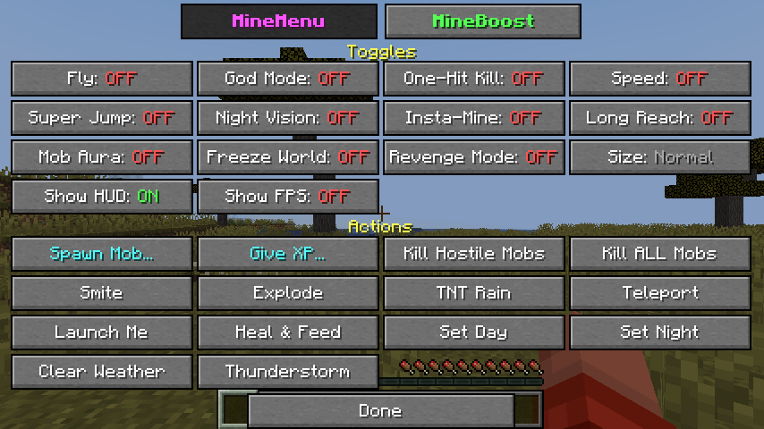
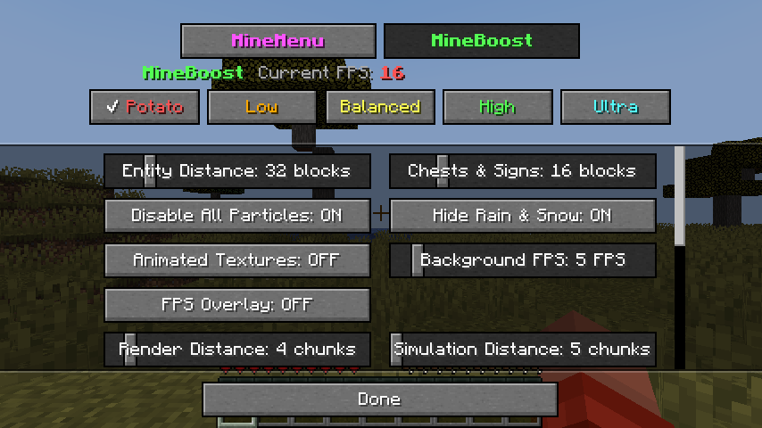

**MineMeBoost 2.0.0**: MineMenu and MineBoost in one mod, for **Minecraft Java 1.21.1** (Fabric).

Press **Right Shift** and pick a tab at the top: **MineMenu** or **MineBoost**.

| MineMenu tab | MineBoost tab |
|---|---|
|  |  |

## What's inside

- **MineMenu (2.0.2):** fly, god mode, one-hit kill, speed, super jump, night vision, insta-mine, long reach, mob aura, freeze world, Revenge Mode, giant/tiny size, FPS counter, spawn any mob, give XP, kill mobs, smite, explode, TNT rain, teleport, launch, heal, time and weather. Singleplayer only.
- **MineBoost (1.0.1):** Potato/Low/Balanced/High/Ultra presets, the graphics settings that matter for FPS, extra boosts (entity distance, chests & signs distance, disable all particles, hide rain & snow, animated textures, background FPS) and an FPS overlay. Works everywhere.

## How it works

- **Right Shift** opens the tab you used last.
- **`.`** still opens MineBoost directly.
- On a server, Right Shift opens MineBoost and the MineMenu tab is greyed out (MineMenu is singleplayer only).

## Fixed

- Clicking a MineBoost preset no longer stacks a second copy of the menu on top of the first (overlapping text, several ✔ marks).

## Install

1. Install the [Fabric Loader](https://fabricmc.net/use/installer/) for Minecraft **1.21.1**.
2. Put [Fabric API](https://modrinth.com/mod/fabric-api) (1.21.1) and **`minemeboost-2.0.0.jar`** (below) in your `.minecraft/mods` folder.
3. **Remove `minemenu-*.jar` and `mineboost-*.jar`.** MineMeBoost already contains both, and Fabric won't start with both installed.
4. Join a world and press **Right Shift**.

See the [README](https://github.com/peachiu/MineMenu/blob/minemeboost-v2.0.0/minemeboost/README.md) for details.
