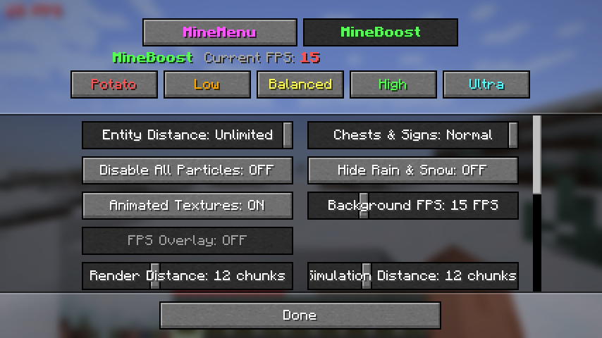
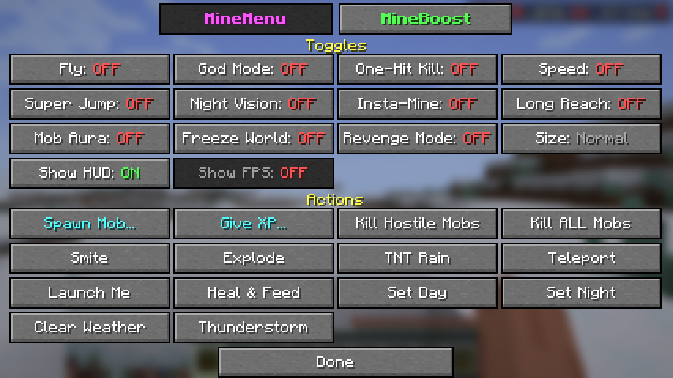

MineMeBoost 2.0.1 for **Minecraft Java 1.21.1** (Fabric): only one FPS counter at a time.

## What's new

MineMenu's **Show FPS** and MineBoost's **FPS Overlay** can no longer be on together:

- Turn on **Show FPS** in the MineMenu tab, and **FPS Overlay** in the MineBoost tab is greyed out and can't be turned on.
- Turn on **FPS Overlay** in the MineBoost tab, and **Show FPS** in the MineMenu tab is greyed out and can't be turned on.
- Hover the greyed-out button to see why. Turn the other one off and it unlocks.

| FPS Overlay greyed out | Show FPS greyed out |
|---|---|
|  |  |

## Install

1. Install the [Fabric Loader](https://fabricmc.net/use/installer/) for Minecraft **1.21.1**.
2. Put [Fabric API](https://modrinth.com/mod/fabric-api) (1.21.1) and **`minemeboost-2.0.1.jar`** (below) in your `.minecraft/mods` folder. Remove `minemeboost-2.0.0.jar`, and any `minemenu-*.jar` or `mineboost-*.jar`.
3. Join a world and press **Right Shift**.

See the [README](https://github.com/peachiu/MineMenu/blob/minemeboost-v2.0.1/minemeboost/README.md) for everything MineMeBoost does.
