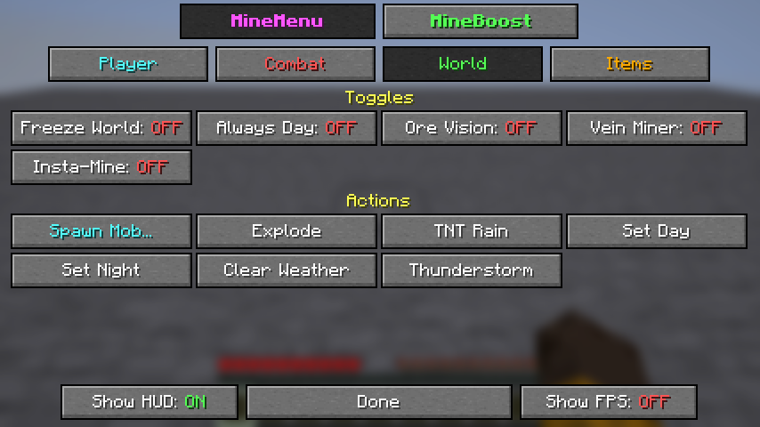
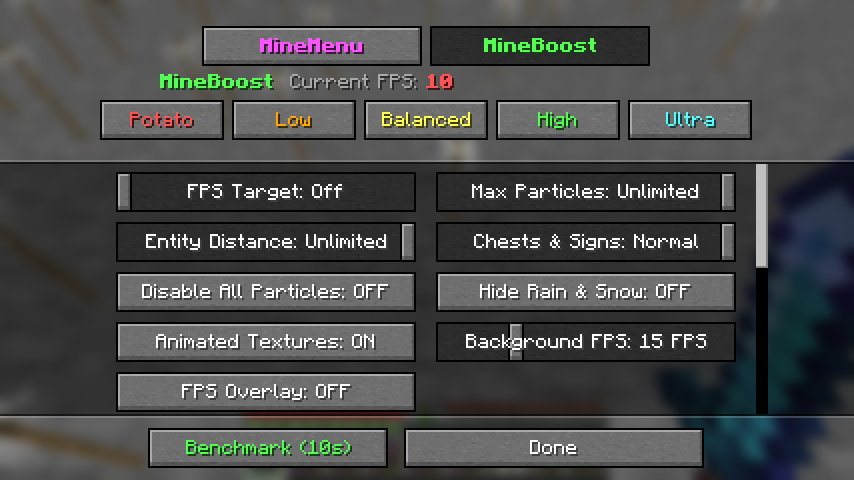
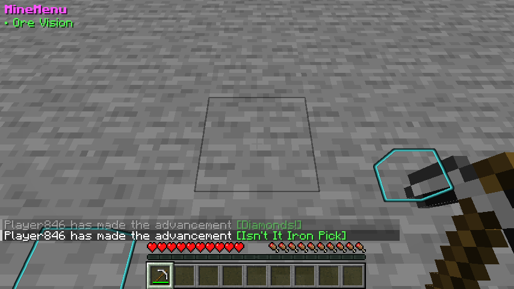
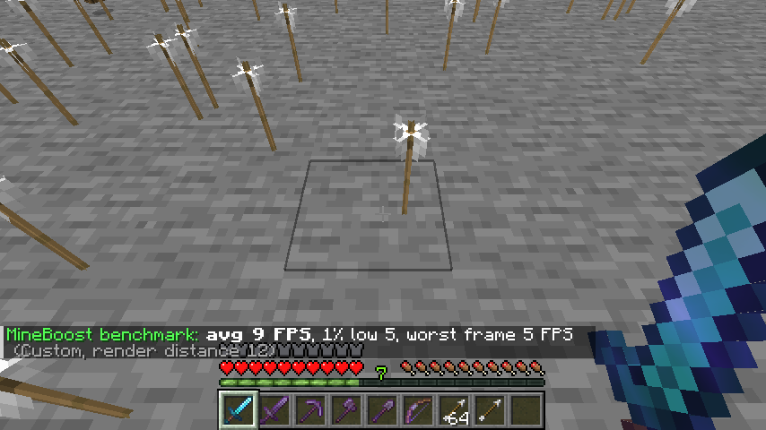

**MineMeBoost 3.0.0** for **Minecraft Java 1.21.1** (Fabric): 13 new hacks and 3 new FPS boosts.

| MineMenu tab (World page) | MineBoost tab |
|---|---|
|  |  |

## MineMenu tab: new hacks (singleplayer)

The MineMenu tab now has four pages: **Player**, **Combat**, **World** and **Items**.

- **Ore Vision:** ores within 20 blocks glow through walls, each in its own colour.
- **Vein Miner:** break one log or ore and the whole tree or vein comes down. Sneak for one block.
- **Item Magnet**, **Mob Glow**, **Mega Knockback**, **Infinite Items**, **Keep Inventory**, **Always Day**.
- Actions: **Fireball**, **Arrow Rain**, **Super Enchant**, **Repair All**, **Netherite Kit**.

## MineBoost tab: more FPS

- **Smart Render Distance (FPS Target):** pick an FPS and MineBoost lowers or raises your render distance by itself to hold it.
- **Max Particles:** caps particles so TNT and farms don't tank your FPS.
- **Benchmark (10s):** measures your FPS and posts the average, 1% low and worst frame in chat.

## Install

1. Install the [Fabric Loader](https://fabricmc.net/use/installer/) for Minecraft **1.21.1**.
2. Put [Fabric API](https://modrinth.com/mod/fabric-api) (1.21.1) and **`minemeboost-3.0.0.jar`** (below) in your `.minecraft/mods` folder. Remove the old `minemeboost` jar, and any `minemenu-*.jar` or `mineboost-*.jar`.
3. Join a world and press **Right Shift**.

See the [MineMeBoost README](https://github.com/peachiu/MineMenu/blob/minemeboost-v3.0.0/minemeboost/README.md) for everything it does.
