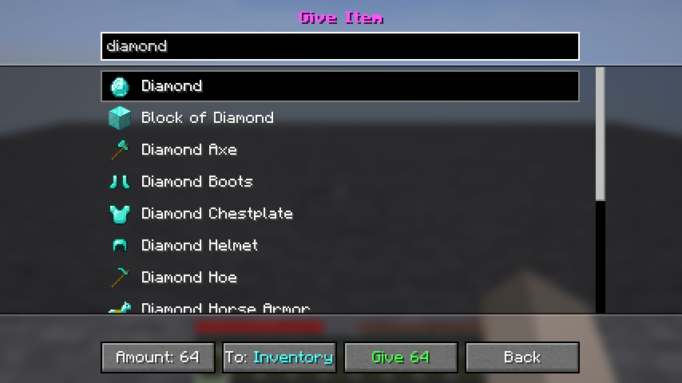

MineMeBoost 3.0.1 for **Minecraft Java 1.21.1** (Fabric): give yourself any item.

## New: Give Item

In the MineMenu tab, go to the **Items** page and click **Give Item...**.

- **Every item in the game**, with icons, in a searchable list. The best match is picked as you type.
- **Amount:** 1, 16, 32 or 64. Tools, armor and other items that don't stack come one at a time.
- **To: Inventory** puts it straight in your inventory; if it's full, the rest drops at your feet.
- **To: Ground** drops it on the block you're looking at.
- Press **Enter**, double-click the item or click **Give**. The list stays open so you can grab several things in a row.

## Install

1. Install the [Fabric Loader](https://fabricmc.net/use/installer/) for Minecraft **1.21.1**.
2. Put [Fabric API](https://modrinth.com/mod/fabric-api) (1.21.1) and **`minemeboost-3.0.1.jar`** (below) in your `.minecraft/mods` folder. Remove the old `minemeboost` jar, and any `minemenu-*.jar` or `mineboost-*.jar`.
3. Join a singleplayer world, press **Right Shift**, then **Items → Give Item...**.

See the [MineMeBoost README](https://github.com/peachiu/MineMenu/blob/minemeboost-v3.0.1/minemeboost/README.md) for everything it does.
