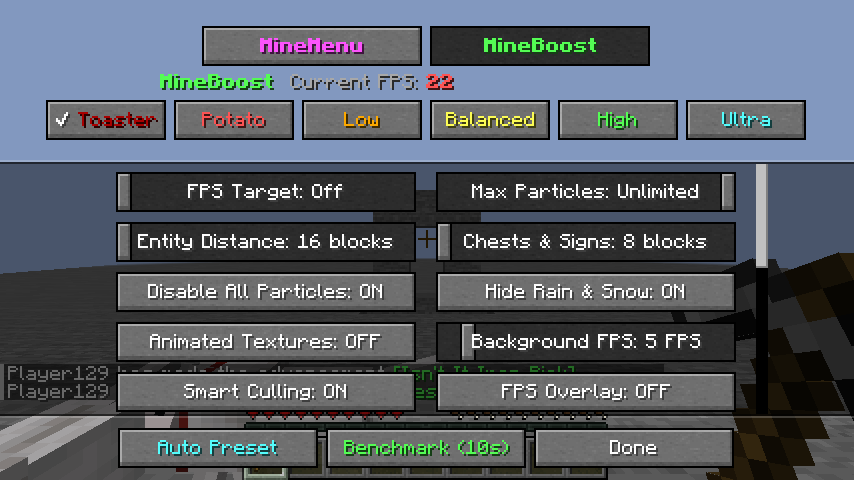

MineMeBoost 3.1.0 for **Minecraft Java 1.21.1** (Fabric): 8 new hacks and 3 FPS upgrades.

## MineMenu tab: new hacks (singleplayer)

**Player page**
- **Water Walk:** walk on water and lava as if they were solid ground. Sneak to sink in.
- **Spider Climb:** walk into a wall to climb straight up it.
- **No Fall Damage:** falling never hurts, from any height.

**Combat page**
- **Thor Mode:** every mob you hit is struck by lightning (8 extra damage and fire). It never hurts you or sets the ground on fire.
- **Explosive Arrows:** your arrows explode like a creeper when they hit a block or a mob.
- **Wolf Army** *(action)*: 5 tamed wolves appear and fight for you.

**World page**
- **Auto Smelt:** mined blocks drop already smelted (iron, gold and copper ingots, glass, stone...). Works with Vein Miner.
- **Clear Ground Items** *(action)*: removes dropped items and stuck arrows within 64 blocks (your trident stays).

## MineBoost tab: more FPS

- **Smart Culling** (on by default): mobs, items, chests and signs hidden behind solid blocks aren't drawn. Glass and leaves never hide anything, and things near you, glowing mobs and Ore Vision markers are always drawn.
- **Auto Preset:** tries the presets from Ultra down and keeps the best looking one that reaches your FPS Target (or 60 FPS).
- **Toaster preset:** even lighter than Potato (2 chunk view distance).

How much Smart Culling helps depends on how much is hidden behind walls: in our test, 100 mobs sealed in a stone box went from 100 drawn to 0 drawn. On the test PC (no graphics card) the FPS difference was too small to measure reliably, so we're not promising a number.

## Install

1. Install the [Fabric Loader](https://fabricmc.net/use/installer/) for Minecraft **1.21.1**.
2. Put [Fabric API](https://modrinth.com/mod/fabric-api) (1.21.1) and **`minemeboost-3.1.0.jar`** (below) in your `.minecraft/mods` folder. Remove the old `minemeboost` jar, and any `minemenu-*.jar` or `mineboost-*.jar`.
3. Join a world and press **Right Shift**.

See the [MineMeBoost README](https://github.com/peachiu/MineMenu/blob/minemeboost-v3.1.0/minemeboost/README.md) for everything it does.
