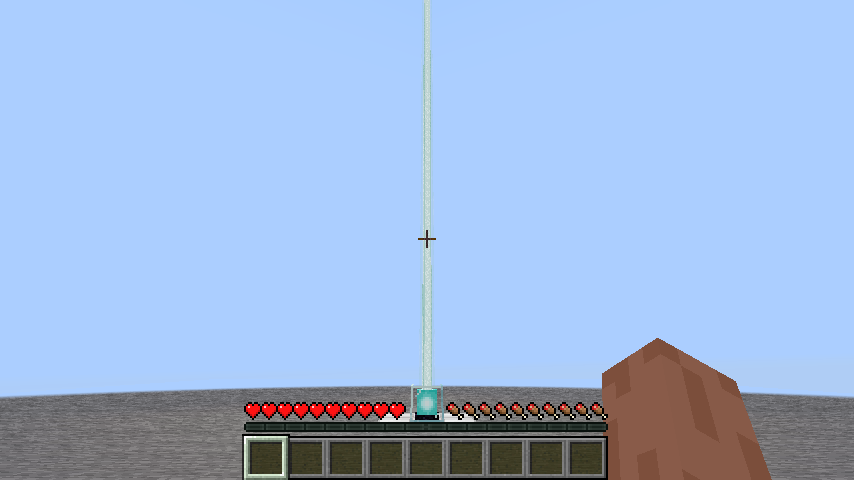
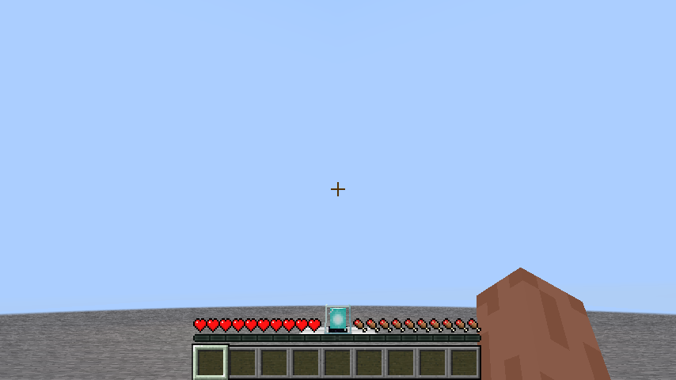

MineMeBoost 3.2.0 for **Minecraft Java 1.21.1** (Fabric): 10 new hacks and 10 new FPS settings.

## MineMenu tab: 10 new hacks (singleplayer)

**Player page**
- **Jetpack:** hold jump to fly upwards, no Fly needed (no fall damage while it's on).
- **Feather Fall:** fall about 9 times slower.
- **Ride Mob** *(action)*: ride the mob you're looking at. Sneak to get off.
- **Set Home / Go Home** *(actions)*: teleport back home from anywhere, even another dimension. Saved per world.

**Combat page**
- **Stun Hits:** every mob you hit freezes for 10 seconds.
- **Mob Rain** *(action)*: 20 random mobs fall from the sky.
- **Resize Mob** *(action)*: the mob you're looking at becomes giant, then tiny, then normal.

**World page**
- **Auto Replant:** harvested crops plant themselves again.
- **Peace Mode:** no new mobs spawn.
- **Grow Plants** *(action)*: every crop and sapling within 8 blocks grows fully. Saplings become trees.

## MineBoost tab: 10 new FPS settings

- **Max Entities:** only the closest mobs are drawn (great at farms).
- **Particle Range:** far-away particles aren't created.
- **Item Distance:** dropped items farther than 4 to 12 blocks aren't drawn.
- **Simple Items:** a dropped stack is drawn as 1 item instead of up to 5.
- **Hide Decorations:** armor stands, item frames and paintings.
- **Hide Beacon Beams**, **Hide Sky**, **Hide Name Tags**, **Hide Vignette**.
- **Menu FPS:** lower FPS while a menu is open, so your PC runs cooler (it doesn't change FPS while playing).

The Toaster, Potato, Low and Balanced presets now use Max Entities, Item Distance, Simple Items and Particle Range too.

| Hide Beacon Beams off | on |
|---|---|
|  |  |

## Install

1. Install the [Fabric Loader](https://fabricmc.net/use/installer/) for Minecraft **1.21.1**.
2. Put [Fabric API](https://modrinth.com/mod/fabric-api) (1.21.1) and **`minemeboost-3.2.0.jar`** (below) in your `.minecraft/mods` folder. Remove the old `minemeboost` jar, and any `minemenu-*.jar` or `mineboost-*.jar`.
3. Join a world and press **Right Shift**.

See the [MineMeBoost README](https://github.com/peachiu/MineMenu/blob/minemeboost-v3.2.0/minemeboost/README.md) for everything it does.
