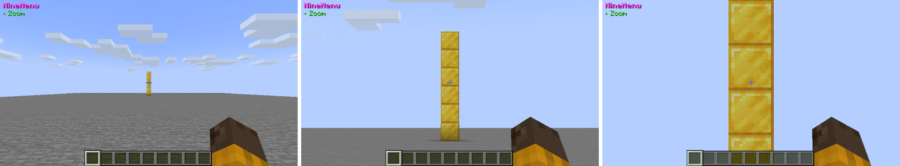

MineMeBoost 3.3.0 for **Minecraft Java 1.21.1** (Fabric): 16 new hacks, waypoints, time & weather control, a structure finder, and measured FPS gains.

## MineBoost tab: more FPS, measured

- **Intel iGPU preset**: made for laptops with Intel UHD / Iris graphics (like an i3-1005G1). No menu blur, clouds, Fancy leaves or shadows; keeps smooth lighting and 8 chunks.
- **Simple Far Mobs**: armor, held items and other extra layers aren't drawn on far mobs. **+31% FPS, +48% 1% low** with 98 armored zombies in view (+13% on top of Sodium).
- **Idle Mode**: lower FPS after 15 s to 5 min without touching anything; full FPS the moment you press a key or move the mouse. Off by default.
- **Max Particles: the closest particles win**: at the limit, the farthest particles are removed first, so the ones near you still show.
- **Benchmark compares with your last run**: "vs last run: avg 41 → 52 (+27%), 1% low ..." plus the settings you changed in between, so you can measure one option on your own PC.
- **Every tooltip has an "Impact:" line** with the gain we measured (see [the measurements](https://github.com/peachiu/MineMenu/blob/minemeboost-v3.3.0/mineboost/docs/fps-measurements.md)).
- **Works with Sodium, Lithium, FerriteCore, ImmediatelyFast and EntityCulling**: detected at start-up and shown on the screen. With EntityCulling, Smart Culling switches itself off (same job); with Sodium the vanilla Chunk Builder setting is hidden. Tested with all five installed at once: no crashes.

Measured and **left out** because they made no difference: Smooth Chunk Loading (limiting chunk uploads per frame), Animation LOD and turning fog off.

## MineMenu tab: 16 new hacks (singleplayer)

**Player**: **Noclip** (spectator mode, back to your game mode when off), **Zoom** (hold Z, scroll to zoom 1.5× to 50×), **Step-Up**, **Fast Swim**, **Elytra Boost**, **Auto-Eat**, **Auto-Tool**, and **Waypoints...**: 5 named waypoints per world with an arrow and distance in your HUD. Your old Home moves into them by itself; Set Home / Go Home still work.

**Combat**: **Auto-Totem**, **Tame Anything** (right-click any mob with an empty hand: it follows you, never attacks you, and attacks what you hit), **Always Crit**.

**World**: **Chest ESP** (chests, barrels, shulkers and ender chests glow through walls), **Growth Aura**, **Fast Breed**, **Time & Weather...** (exact time, day speed from stopped to 60×, sun/rain/thunder) and **Find Structure...** (19 structures, the nearest one shows in your HUD).

**Items**: **Infinite Durability**, **Auto-Fish**, **Instant Build** (20 blocks a second instead of 5).

| Player page | World page |
|---|---|
|  |  |

| Waypoints | Time & Weather |
|---|---|
|  |  |

| Zoom: off, 4×, 10× | Chest ESP |
|---|---|
|  |  |

All hacks only work in your own singleplayer world, like before (they switch off on servers and when you open to LAN).

## Install

1. Install the [Fabric Loader](https://fabricmc.net/use/installer/) for Minecraft **1.21.1**.
2. Put [Fabric API](https://modrinth.com/mod/fabric-api) (1.21.1) and **`minemeboost-3.3.0.jar`** (below) in your `.minecraft/mods` folder. Remove the old `minemeboost` jar, and any `minemenu-*.jar` or `mineboost-*.jar`.
3. Your `config/mineboost.json` and your worlds' Homes carry over.
