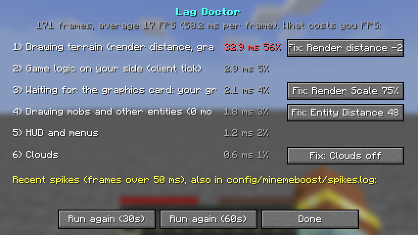
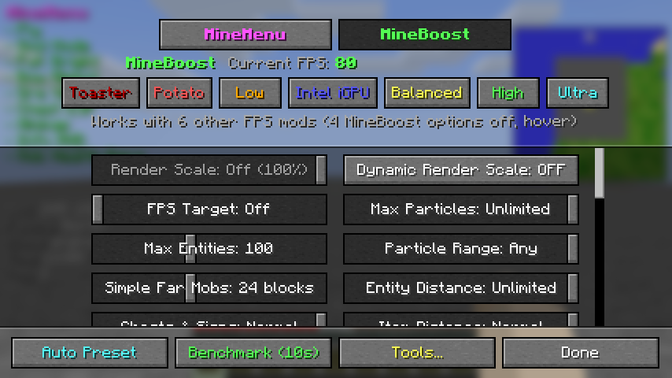
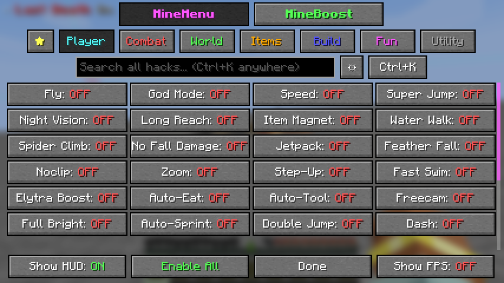
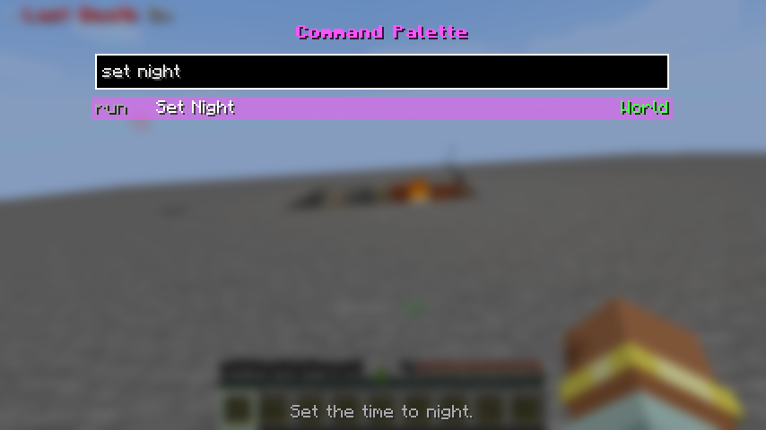
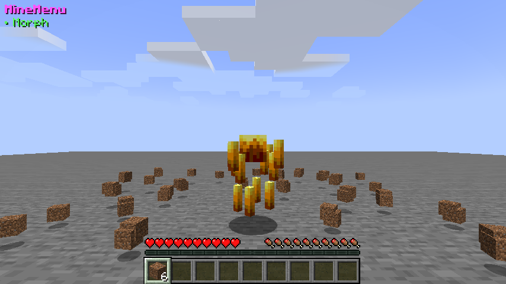
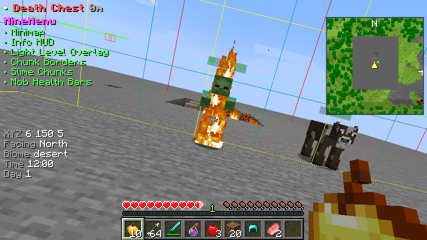

MineMeBoost 3.4.0 for **Minecraft Java 1.21.1** (Fabric): Render Scale and a Lag Doctor for FPS, a reworked menu with search, favorites, a Command Palette and Safe Mode, three new pages (Build, Fun, Utility) and about 50 new hacks.

## MineBoost tab (2.4): FPS

- **Render Scale**: draws the world at 50-99% of your resolution and scales it up; the HUD, chat and menus stay sharp. **+15% FPS at 50%** on our test PC (+17% at 75% in a busy scene); most useful on integrated graphics. **Dynamic Render Scale** only lowers it when you're below your FPS target. Off with Iris (shaders have their own resolution settings) and with Fabulous graphics.
- **Lag Doctor** (Tools...): measures 10/30/60 s and shows what costs you FPS ("Drawing terrain 56%..."), each finding with a one-click fix. Frames over 50 ms go to `config/minemeboost/spikes.log` with what was happening.
- **A/B test of every boost**: each one off/on twice on your PC; the table is saved to `config/minemeboost/benchmark-results.md`, ready to share.
- **Memory panel** with a **JVM Advisor** (how much RAM to give Minecraft on your PC, flags to copy), **context rules** (another preset in the Nether, underground, flying an elytra...), **FPS profiles** you can share as a code, a **frame-time graph**, **Battery Saver** (30 FPS + Render Scale 70%, one key), **Max Sounds** and **Smooth Fog Edge**.
- **Faster in the background**: Ore Vision and Chest ESP now scan on a background thread and only rescan the 16×16×16 section that changed; Smart Culling's cache no longer causes a small hitch every 3 seconds; particle and entity budgets use primitive collections.
- Measured and **left off by default** because they gave no gain: **Section Culling** (−7%, Smart Culling already does the job) and **Far Entity Ticks** (−2%). All numbers: [fps-measurements.md](https://github.com/peachiu/MineMenu/blob/minemeboost-v3.4.0/mineboost/docs/fps-measurements.md).
- Tested with **Sodium, Lithium, FerriteCore, ImmediatelyFast, EntityCulling**, and with **Iris + Mod Menu**: no crashes or mixin errors; Render Scale turns itself off with Iris, Section Culling with Sodium.

| Lag Doctor | Works with 6 FPS mods (Iris installed) |
|---|---|
|  |  |

## MineMenu tab (3.4)

**Menu**: a **★ Favorites** page, a **search** box, **right-click any button** for its settings, a key or a favorite, a **Command Palette (Ctrl+K)** anywhere, themes (Dark, Light, Glass) with an accent colour, **profiles** you can share as a code, **Macros**, and your hacks, keys and settings are remembered between sessions (`config/minemeboost/cheats.json`). With **Mod Menu**, the config button opens the menu.

**Safe Mode**: a hack that throws an error is switched off, with a message in the corner, instead of crashing the game. If the game fails to start twice in a row, the next start keeps every hack off. **⚙ → Reset everything** (with a backup).

**Player**: Freecam, Full Bright, Auto-Sprint, Double Jump, Dash (V), Scaffold, Lava Swim, Gravity Control, **Morph** (look like any mob and use its power with R: fireballs, teleport, explosion, wall climbing, flying; U, dying, leaving or changing dimension turns you back), Phase, Remote Chest (ender chest, crafting table, anvil, enchanting, a marked chest from anywhere), 10 waypoints and **Last Death**.

**Combat**: Bow Aimbot, Lifesteal, Force Field, Thorns Aura, Mind Control (N), Trident Storm, Mob War, **Boss Arena**, Armor Loadouts.

**Build** (new page): Selection Wand, Copy / Paste with a preview, Rotate, Mirror, Fill, Clear, Undo / Redo (10 steps), Schematics (.nbt), instant Structures, Terrain Brush, Biome Painter, Gravity Gun. Big jobs are built a few thousand blocks per tick: filling 64×64×64 never freezes the game.

**Fun** (new page): Chaos Mode, Lucky Blocks, Floor is Lava, Random Drops, Mob Swap, Meteor Strike, Tornado.

**Utility** (new page): Minimap with a big map (M), Info HUD, Light Level Overlay, Chunk Borders, Slime Chunks, Mob Health Bars, Macros.

**Items / World**: Item Creator, Potion Creator, Mob Creator, Inventory Snapshots, Duplicate, Auto-Sort, Loot Refill, Magnet Filter, Death Chest, Nuker.

| Menu | Command Palette |
|---|---|
|  |  |

| Morph | Minimap and Utility |
|---|---|
|  |  |

**Where hacks work**: your singleplayer worlds and, new, a world you open to LAN (only for you, the host). On a multiplayer server they stay off and nothing is sent to the server; only the Minimap (without mobs), Info HUD and Chunk Borders work there. MineBoost works everywhere.

**Fixes from 3.3**: Always Day and a stopped Day Speed no longer fight over the daylight rule; waypoint renames are thread-safe; Ore Vision and Chest ESP no longer place server-side markers; Smart Culling's 3-second hitch is gone.

## Install

1. Install the [Fabric Loader](https://fabricmc.net/use/installer/) for Minecraft **1.21.1**.
2. Put [Fabric API](https://modrinth.com/mod/fabric-api) (1.21.1) and **`minemeboost-3.4.0.jar`** (below) in your `.minecraft/mods` folder. Remove the old `minemeboost` jar, and any `minemenu-*.jar` or `mineboost-*.jar`.
3. Your `config/mineboost.json` (from 3.2 or 3.3) and your worlds' waypoints carry over.
