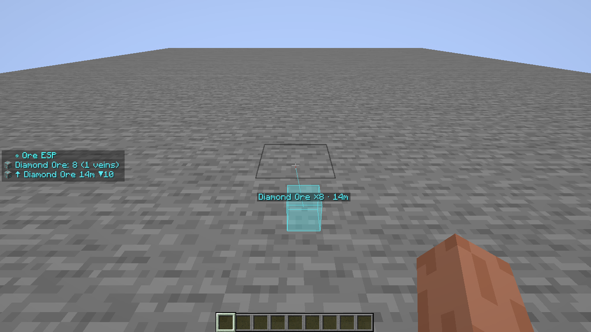
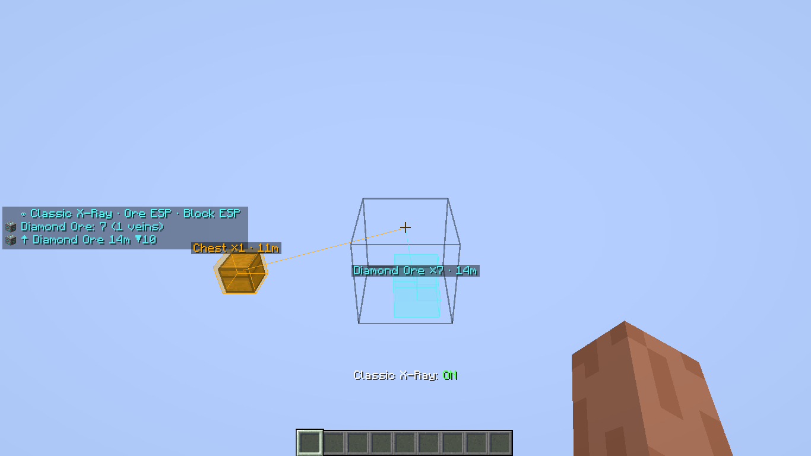
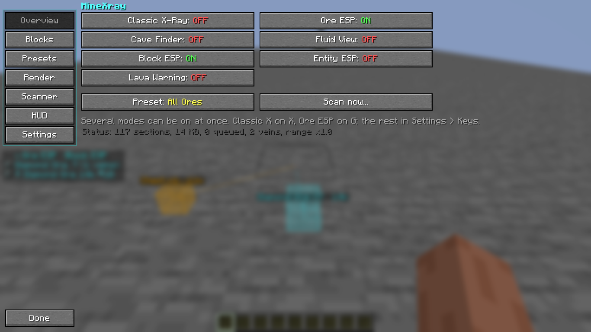
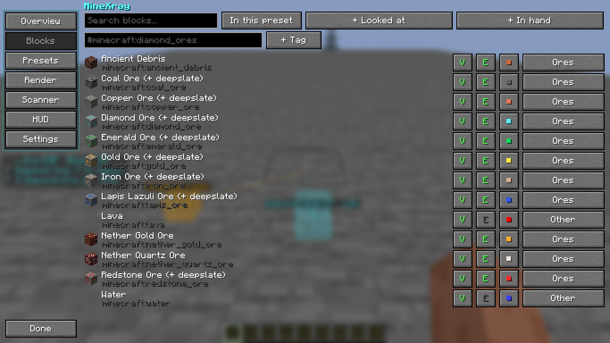

# MineXray

**X-ray and ESP for singleplayer**, for **Minecraft Java 1.21.1** (Fabric). Also part of [MineMeBoostXray](../minemeboost/README.md), where it's the third tab next to MineMenu and MineBoost.

Press **Right Shift** to open it. Like the MineMenu cheats, it only works in your own worlds (singleplayer, or a LAN world you host). On a multiplayer server every mode is off, the tab says "MineXray only works in singleplayer", and nothing is scanned, drawn or sent.

| Ore ESP: whole veins, labels, tracers | Classic X-Ray |
|---|---|
|  |  |

| The tab | Block editor |
|---|---|
|  |  |

## What it does

Everything is described in the [MineXray section of the MineMeBoostXray README](../minemeboost/README.md#minexray-new-in-36):

- **Modes:** Classic X-Ray (X), Ore ESP (G), Cave Finder, Fluid View, Lava Warning, Block ESP, Entity ESP.
- **Tools:** block editor, presets with automatic switching per dimension, vein scanner, HUD.

On its own, MineXray has no waypoints and no A/B cost test; those come from MineMenu and MineBoost inside MineMeBoostXray.

## Install

1. Install the [Fabric Loader](https://fabricmc.net/use/installer/) for Minecraft **1.21.1**, and put [Fabric API](https://modrinth.com/mod/fabric-api) in `.minecraft/mods`.
2. Download `MineXray-1.0.1.jar` from the [Releases page](https://github.com/peachiu/MineMenu/releases) into the same `mods` folder.
3. **Not together with MineMeBoostXray** (it already contains MineXray). It works next to MineMenu or MineBoost on their own.

Settings are in `config/minexray/minexray.json` and `config/minexray/xray-presets/`.

## Building

You need **Java 21**.

```bash
cd minexray
./gradlew build            # build/libs/MineXray-1.0.1.jar
./gradlew runClientTests   # starts the real jar in a client (needs Xvfb on Linux) and checks it
```

The code lives here and is also built into MineMeBoostXray (`../minemeboost`), which connects it to MineMenu and MineBoost through `XrayHost`.
